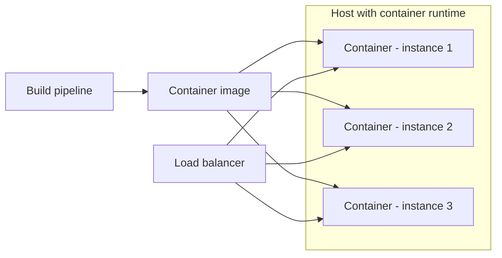

# Service Instance per Container

## Description

The service is packaged as a container image (for example, Docker) and each instance runs as a container. The container is an operating-system-level virtualization mechanism, with process, file system, and network isolation, plus CPU and memory limits.

Scaling is done by changing the number of containers. Since only the application process is started, not a full operating system, building and starting containers is much faster than with VMs.

## Problems it solves

- Isolation between instances of services with different technologies.
- CPU and memory limits per instance.
- Fast builds and deployments.
- Efficient use of resources, with high density per host.

## When to use

- When you want frequent deployments and fast startup.
- When there are many heterogeneous services that need isolation and density.
- When an orchestrator or a deployment platform is available.

## When to avoid

- When the organization isn't mature enough to operate container infrastructure.
- When stronger isolation than the shared kernel provides is required.

## Trade-offs

| Benefit | Cost / Risk |
| --- | --- |
| Simple scaling by changing the number of containers | Container infrastructure is less mature than VM infrastructure |
| Technology is hidden; all services start and stop the same way | Need for orchestration and cluster management |
| Isolation and resource limits per container | Weaker isolation than VMs (shared kernel) |
| Very fast build and startup | Networking, storage, and security complexity |

- In practice, it's usually combined with an orchestrator (Service Deployment Platform).

## Diagram

The image produces several containers that share the host's kernel.

## Related patterns

- [Service Instance per Host](/architecture/microservices/deployment/service-instance-per-host) — the pattern this approach refines.
- [Service Instance per VM](/architecture/microservices/deployment/service-instance-per-vm) — an alternative with stronger isolation, but heavier.
- [Serverless Deployment](/architecture/microservices/deployment/serverless-deployment) — an alternative that hides the infrastructure.
- [Service Deployment Platform](/architecture/microservices/deployment/service-deployment-platform) — a platform that orchestrates containers.

## Reference

- [Pattern page on microservices.io](https://microservices.io/patterns/deployment/service-per-container.html)
