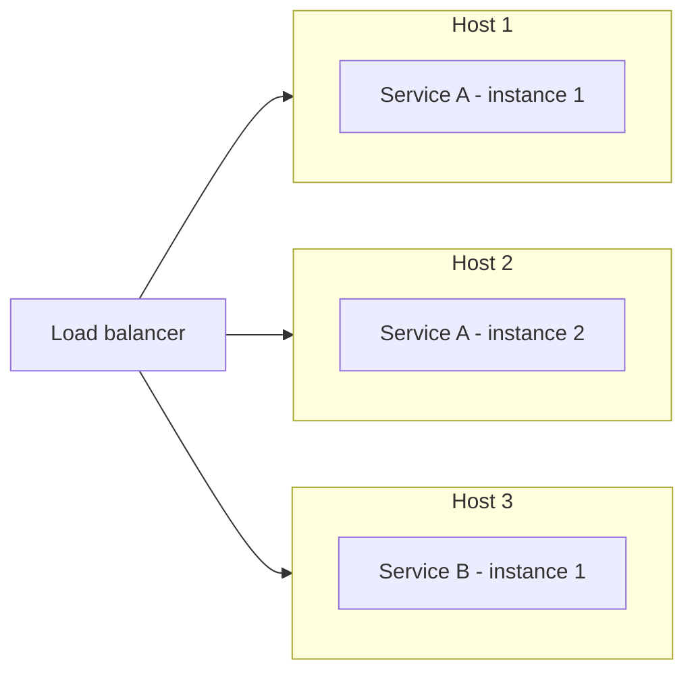

# Service Instance per Host

## Description

Each service instance is deployed on its own host, which can be a physical or virtual machine. No other service shares that host, so the instance can consume at most the host's resources.

The pattern is a general deployment principle and is refined by using virtual machines (Service Instance per VM) and containers (Service Instance per Container).

## Problems it solves

- Isolation between service instances.
- Conflicts in resource requirements and dependency versions between services.
- Limiting the CPU and memory consumption of each instance.
- Simple monitoring, management, and redeployment of each instance.

## When to use

- When services have different technology stacks and dependencies.
- When isolation and resource predictability are priorities.
- As the conceptual basis for VMs, containers, or deployment platforms.

### When to avoid

- When the cost of one host per instance is prohibitive.
- When the services are very small and would leave hosts underused.

## Trade-offs

| Benefit | Cost / Risk |
| --- | --- |
| Full isolation between instances | Less efficient use of resources |
| No dependency or resource conflicts | More hosts to provision and pay for |
| Each instance consumes at most one host's resources | Possible host underutilization |
| Simple monitoring and redeployment | Greater provisioning overhead, depending on the host type |

- Real efficiency depends on the host type: VMs and containers reduce waste.

## Diagram

Each service instance occupies a dedicated host.

## Related patterns

- [Multiple Service Instances per Host](/architecture/microservices/deployment/multiple-service-instances-per-host) — an alternative that shares the host.
- [Service Instance per VM](/architecture/microservices/deployment/service-instance-per-vm) — a refinement that uses virtual machines.
- [Service Instance per Container](/architecture/microservices/deployment/service-instance-per-container) — a refinement that uses containers.
- [Serverless Deployment](/architecture/microservices/deployment/serverless-deployment) — an alternative that abstracts away the host.

## Reference

- [Pattern page on microservices.io](https://microservices.io/patterns/deployment/single-service-per-host.html)
