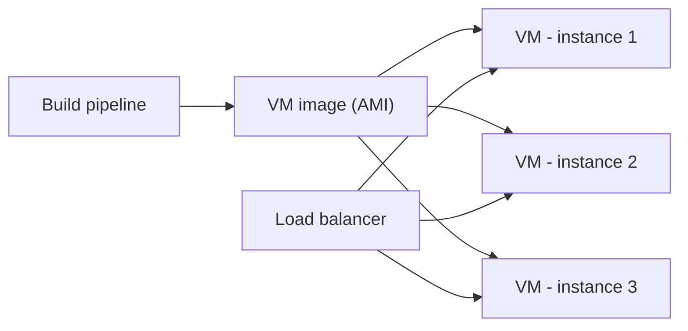

# Service Instance per VM

## Description

The service is packaged as a virtual machine image and each instance is deployed as a separate VM. The image contains the operating system, the runtime, and the service code, and new instances are created from it.

Scaling is done by increasing or decreasing the number of VMs, which IaaS platforms automate with autoscaling groups and load balancers. A classic example is Netflix, which packages each service as an AMI and runs each instance on an EC2 instance.

## Problems it solves

- Isolation between instances of different services.
- Heterogeneous technology stacks handled uniformly.
- CPU and memory limits per instance.
- Reliable deployment with mature infrastructure tooling.

## When to use

- When you already use an IaaS platform with mature autoscaling and load balancing.
- When strong isolation between services is required.
- When the team prefers an immutable, uniform deployment unit.

### When to avoid

- When you need to build and deploy very frequently and quickly.
- When the cost and slowness of creating images make the delivery cycle unworkable.

## Trade-offs

| Benefit | Cost / Risk |
| --- | --- |
| Simple scaling by instance count, with autoscaling | Building VM images is slow and time-consuming |
| The VM hides the technology stack; all services start and stop the same way | Large images, with a full operating system |
| Isolation between instances | Lower density than containers |
| CPU and memory limits enforced by the VM | Longer startup time |
| Mature IaaS tooling (load balancers, autoscaling groups) | Resource cost per VM |

## Diagram

A single VM image produces several instances, behind a load balancer.

## Related patterns

- [Service Instance per Host](/architecture/microservices/deployment/service-instance-per-host) — the pattern this approach refines.
- [Service Instance per Container](/architecture/microservices/deployment/service-instance-per-container) — a lighter, faster alternative.
- [Serverless Deployment](/architecture/microservices/deployment/serverless-deployment) — an alternative that hides the infrastructure.

## Reference

- [Pattern page on microservices.io](https://microservices.io/patterns/deployment/service-per-vm.html)
