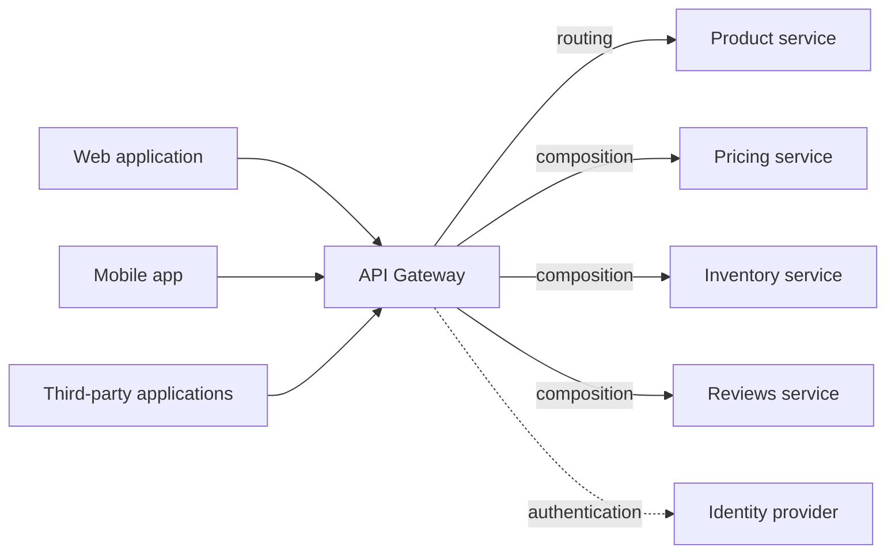

# API Gateway

## Description

The API Gateway is the single entry point between clients and an application's microservices. Instead of each client knowing about and calling dozens of fine-grained services directly, clients send their requests to the gateway, which decides what to do with each one.

The gateway handles requests in two ways: some are simply routed (proxied) to the responsible service; others require a fan-out, where the gateway calls several services and combines the results into a single response. It also centralizes cross-cutting responsibilities, such as authentication and authorization, and can expose a tailored API for each type of client, translating public protocols (for example, HTTP/REST) to the ones used internally.

In the microservices.io catalog, then, the API Gateway brings together in a single pattern what the cloud catalog splits into three: routing, response composition, and offloading of cross-cutting concerns.

## Problems it solves

- Services expose fine-grained APIs, but clients need data from several services to build a single screen.
- Different clients need different data: a desktop page is richer than its mobile version.
- Mobile networks have higher latency and less bandwidth; the client can only make a few calls, unlike a server-side web application inside the LAN.
- Service instances change host and port dynamically, and clients shouldn't have to discover them.
- The partitioning into services evolves over time and shouldn't leak to clients.
- Some services use protocols that aren't web-friendly (for example, messaging or binary RPC).

## When to use

- The application follows the microservices architecture and has external clients (web, mobile, third parties).
- Screens or use cases depend on data from several services and the number of client round trips is a problem.
- You want to hide the internal structure, the location of instances, and internal protocols from the client.
- A central point is needed to authenticate clients and pass identity information on to the services.

### When to avoid

- The application is a monolith or has few services and a single type of client, and direct access is enough.
- The team can't operate one more critical production component.
- The gateway would tend to accumulate business logic, becoming a new centralized monolith and a bottleneck between teams.

## Trade-offs

| Benefit | Cost / Risk |
| --- | --- |
| Clients are isolated from the partitioning into services and from instance discovery | One more component to develop, deploy, and operate |
| Fewer round trips: one request gathers data from several services | An additional network hop and increased latency (usually small) |
| An API suited to each client and simpler clients | Single point of failure and potential bottleneck if not scaled and replicated |
| Translation between the public protocol and internal protocols | Risk of concentrating logic and becoming a development bottleneck between teams |
| Centralized security and authentication | Changes to services require coordination with the gateway |

- **Performance:** a gateway under heavy load benefits from non-blocking I/O and an event-driven model (for example, Netty/Spring Reactor on the JVM or Node.js).
- **Resilience:** the gateway's calls to services should be protected by Circuit Breaker, with degraded responses when a service fails.
- **Ownership:** to avoid an organizational bottleneck, consider one gateway per client type (Backend for Front-end).

## Diagram

Clients talk only to the gateway. It routes some requests directly to the responsible service, composes responses from several services for others, and applies authentication before forwarding.

## Related patterns

- [Backend for Front-end](/architecture/cloud-design-patterns/gateways-and-edge/backends-for-frontends) — a variation in which each client type has its own gateway.
- [Gateway Routing](/architecture/cloud-design-patterns/gateways-and-edge/gateway-routing) — the cloud catalog's equivalent of the API Gateway's routing/proxy function.
- [Gateway Aggregation](/architecture/cloud-design-patterns/gateways-and-edge/gateway-aggregation) — equivalent to the composition function (fan-out and combining responses).
- [Gateway Offloading](/architecture/cloud-design-patterns/gateways-and-edge/gateway-offloading) — equivalent to delegating cross-cutting responsibilities (TLS, authentication, monitoring) to the gateway.
- [Microservice Architecture](/architecture/microservices/architectural-style/microservice-architecture) — the architectural style that creates the need for the gateway.
- [API Composition](/architecture/microservices/service-collaboration/api-composition) — the gateway often implements it to combine data from several services.
- [Client-side Discovery](/architecture/microservices/service-discovery/client-side-discovery) and [Server-side Discovery](/architecture/microservices/service-discovery/server-side-discovery) — the gateway uses one of them to locate available instances.
- [Access Token](/architecture/microservices/security/access-token) — the gateway authenticates users and passes identity information on to the services.
- [Circuit Breaker](/architecture/cloud-design-patterns/resiliency/circuit-breaker) — protects the gateway's calls to services.

## Reference

- [Pattern page on microservices.io](https://microservices.io/patterns/apigateway.html)
