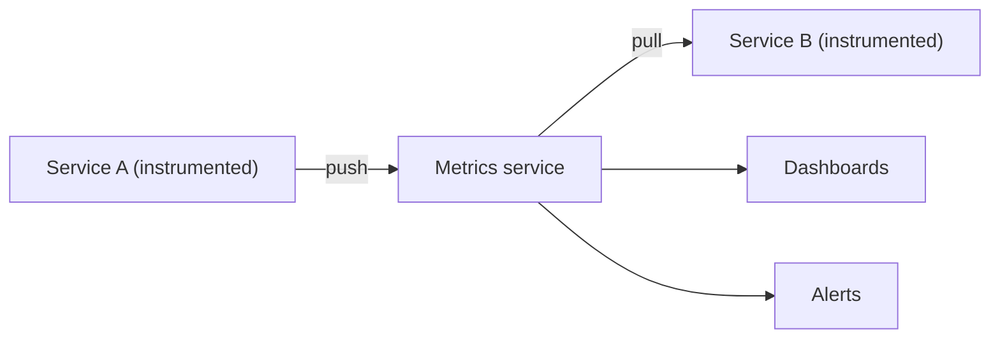

# Application Metrics

## Description

Each service is instrumented to collect statistics about its individual operations, such as request counts, error rates, latencies, and resource usage. These numbers are sent to a central metrics service, which is responsible for reporting and alerting.

Delivery can follow two models: the service pushes the metrics to the central service, or the central service pulls them from an endpoint the service exposes. Instrumentation libraries and aggregation systems exist for both models.

Metrics give a quantitative, low-cost view of system behavior over time, and are the basis for dashboards, SLOs, and alerts.

## Problems it solves

- Understanding the application's behavior and diagnosing its problems
- Getting visibility into each service's individual operations, beyond the external response time
- Doing so with minimal runtime overhead

## When to use

- Any production microservices system that needs dashboards, alerts, and trend analysis
- Tracking latency, error, and saturation SLIs and SLOs

### When to avoid

- Very small systems where the cost of metrics infrastructure outweighs the benefit
- As the only diagnostic mechanism: metrics don't explain detailed causes, so use logs and traces for that

## Trade-offs

| Benefit | Cost / Risk |
| --- | --- |
| Deep insight into application behavior | Metrics code gets mixed into business logic, increasing complexity |
| Alerts based on thresholds and trends | Aggregating metrics can require significant infrastructure |
| Low cost per data point | High label cardinality raises cost and degrades queries |

- Instrumentation libraries and a chassis reduce the coupling of metrics code.
- Choose between push and pull according to the environment (ephemeral instances favor push or service discovery).

## Diagram

Services expose or send metrics to the central service, which feeds dashboards and alerts.

## Related patterns

- [Log Aggregation](/architecture/microservices/observability/log-aggregation) — complements metrics with detailed records
- [Distributed Tracing](/architecture/microservices/observability/distributed-tracing) — shows the path and timing of each request
- [Health Check API](/architecture/cloud-design-patterns/resiliency/health-endpoint-monitoring) — another health signal consumed by monitoring
- [Log Deployments and Changes](/architecture/microservices/observability/log-deployments-and-changes) — a deployment pseudo-metric can be displayed alongside the other metrics
- [Microservice Chassis](/architecture/microservices/cross-cutting-concerns/microservice-chassis) — can embed the standard instrumentation

## Reference

- [Pattern page on microservices.io](https://microservices.io/patterns/observability/application-metrics.html)
