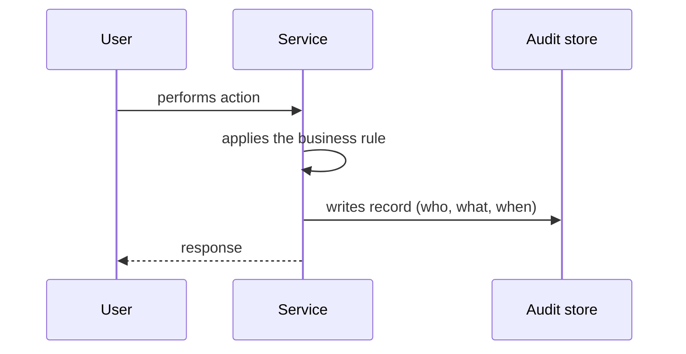

# Audit Logging

## Description

The pattern records user actions (who did what, when, and on which resource) in a dedicated data store, such as a database. Each service writes audit records for the relevant operations it performs.

Unlike application logs, which are aimed at technical diagnosis, the audit log is a reliable business history of user activity. Knowing a user's recent actions helps with customer support, regulatory compliance, and security.

A reliable way to implement auditing is Event Sourcing, where every state change is already recorded as an event.

## Problems it solves

- Understanding user and application behavior and investigating problems
- Meeting compliance and security investigation requirements
- Giving customer support the history of a user's actions

## When to use

- Regulated or sensitive domains (finance, healthcare, access administration)
- When you need to answer questions about who changed a piece of data and when

### When to avoid

- When the action trail has no business, compliance, or security value
- For purely technical diagnosis, where logs and traces are more suitable

## Trade-offs

| Benefit | Cost / Risk |
| --- | --- |
| History of user actions | Audit code gets mixed into business logic, increasing complexity |
| Support for compliance and security | Storage and retention of large volumes, with personal data subject to privacy rules |
| Incident investigation | Writing the audit record and the state change consistently may require transactional care |

- Protect the records against tampering and restrict access.
- Consider aspects, interceptors, or domain events to reduce coupling with the business logic.

## Diagram

The service performs the user's action and writes an audit record to a dedicated store.

## Related patterns

- [Event Sourcing](/architecture/cloud-design-patterns/data-management/event-sourcing) — a reliable way to get auditing, since all changes are events
- [Domain Event](/architecture/microservices/service-collaboration/domain-event) — domain events can feed the audit log
- [Log Aggregation](/architecture/microservices/observability/log-aggregation) — centralized technical logs, complementary to business auditing
- [Log Deployments and Changes](/architecture/microservices/observability/log-deployments-and-changes) — auditing of infrastructure and deployment changes

## Reference

- [Pattern page on microservices.io](https://microservices.io/patterns/observability/audit-logging.html)
