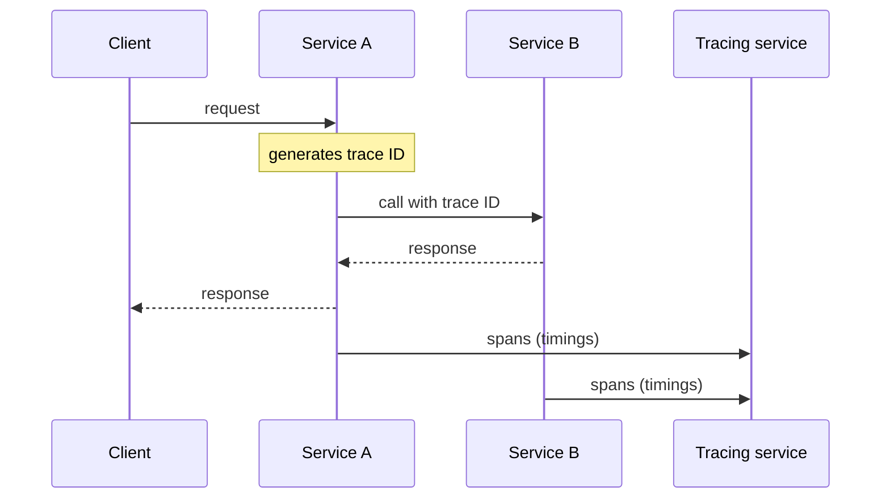

# Distributed Tracing

## Description

In microservices, a single external request often passes through several services, each performing operations such as database queries or publishing messages. External monitoring shows only the total response time and the call count, without detailing the individual operations.

In Distributed Tracing, each service is instrumented to assign a unique identifier to each external request, pass it on to all the services involved, include it in every log message, and send the request's and its operations' timing data (start and end) to a central service. Each operation becomes a span, and the set of spans forms the trace.

This instrumentation usually comes from a microservice chassis or from standardized libraries (for example, OpenTelemetry, Zipkin).

## Problems it solves

- Understanding behavior and diagnosing problems that cross services
- Finding where the latency is in a chain of calls
- Locating the log entries for a single request, scattered across several services
- Doing so with minimal runtime overhead

## When to use

- Requests involving several synchronous or asynchronous services
- Latency analysis and bottleneck identification

## When to avoid

- Systems with few services, where correlated logs are already enough
- When the cost of collecting and storing every trace isn't justified (use sampling)

## Trade-offs

| Benefit | Cost / Risk |
| --- | --- |
| Reveals system behavior and sources of latency | Collecting and storing traces can require significant infrastructure |
| Lets you search for a request by ID in the aggregated logs | Requires consistent context propagation across all services and channels |
| Reusable instrumentation via a chassis | Instrumentation overhead, mitigated by sampling |

- Sampling reduces cost, but may miss rare traces.
- Propagate the context in asynchronous messages too.

## Diagram

The ID generated at the entry point is passed between the services, and each one sends its spans to the central tracing service.

## Related patterns

- [Log Aggregation](/architecture/microservices/observability/log-aggregation) — the request ID appears in every aggregated log message
- [Application Metrics](/architecture/microservices/observability/application-metrics) — complements the trace with aggregated metrics
- [Exception Tracking](/architecture/microservices/observability/exception-tracking) — exceptions can carry the trace ID
- [Microservice Chassis](/architecture/microservices/cross-cutting-concerns/microservice-chassis) — can provide the tracing instrumentation

## Reference

- [Pattern page on microservices.io](https://microservices.io/patterns/observability/distributed-tracing.html)
