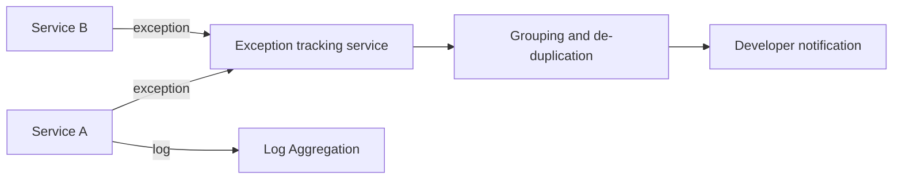

# Exception Tracking

## Description

When a request fails, a service instance throws an exception with an error message and a stack trace. With many instances across many machines, these exceptions are scattered and repeated, which makes it hard to know which are new, which are frequent, and which have already been handled.

The pattern sends all exceptions to a central exception tracking service. It groups (de-duplicates) them, tracks their occurrence, notifies developers, and lets you record the investigation and resolution.

Exceptions should still be written to the logs, in addition to being reported to the tracking service.

## Problems it solves

- Understanding application behavior and diagnosing problems from failures
- De-duplicating, recording, investigating, and fixing exceptions scattered across instances
- Reporting with low runtime overhead

## When to use

- Many services and instances, where reading logs to find exceptions is impractical
- Teams that need to prioritize and track the fixing of errors

## When to avoid

- Small applications, where the existing logs and alerts are enough
- When sensitive data in stack traces and context can't be sent to an external service

## Trade-offs

| Benefit | Cost / Risk |
| --- | --- |
| Visibility into exceptions and tracking of their resolution | The tracking service is additional infrastructure to operate and maintain |
| Automatic grouping and notification | Sensitive data can leak in error payloads |
| Prioritization by frequency and impact | Exception storms require rate limiting and sampling |

- Don't let reporting failures affect the service: report asynchronously and tolerate errors.

## Diagram

Each service reports exceptions to the central service, which groups them and notifies the team, while the logs continue on to aggregation.

## Related patterns

- [Log Aggregation](/architecture/microservices/observability/log-aggregation) — exceptions should be written to the logs in addition to being reported
- [Distributed Tracing](/architecture/microservices/observability/distributed-tracing) — correlates the exception with the request that caused it
- [Application Metrics](/architecture/microservices/observability/application-metrics) — error rates as metrics complement the tracking

## Reference

- [Pattern page on microservices.io](https://microservices.io/patterns/observability/exception-tracking.html)
