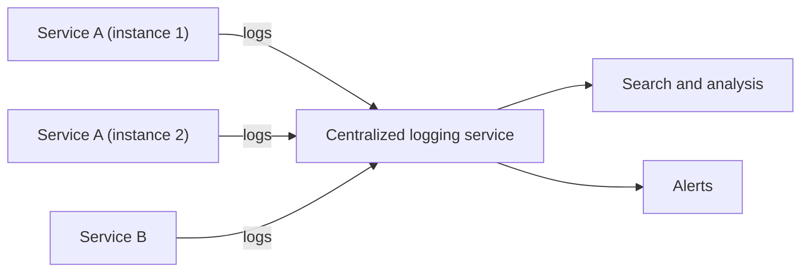

# Log Aggregation

## Description

In a microservices architecture, each service instance writes its own logs (errors, warnings, info, and debug) in a standardized format. Since the system runs on many instances and machines, these records are scattered, and a single user request may pass through several services.

The pattern sends the logs from all instances to a central logging service, which aggregates them. From there, developers and operations staff search and analyze the complete set and configure alerts that fire when certain messages appear.

Collection agents should be lightweight so they don't penalize the services, and logs are usually structured (for example, JSON) with common fields such as service, instance, level, and correlation identifier.

## Problems it solves

- Understanding application behavior and diagnosing problems when the relevant logs are scattered across many instances
- Following a request that crosses several services
- Reducing the runtime impact of log collection
- Triggering alerts from specific messages

## When to use

- Applications with several service instances across multiple machines or containers
- Ephemeral instances, whose local files disappear along with them
- The need for centralized search, analysis, and alerting over log messages

### When to avoid

- Small applications, with few instances, where local logs are enough
- When the log volume and the cost of the aggregation infrastructure aren't justified

## Trade-offs

| Benefit | Cost / Risk |
| --- | --- |
| A single, searchable view of all logs | Large data volume requires considerable ingestion, storage, and query infrastructure |
| Message-based alerts | Excessive or noisy logs raise cost and make it harder to find what matters |
| Logs survive instance disposal | Sensitive data in logs requires access control and masking |

- Keep overhead in the services minimal, preferring buffered asynchronous shipping.
- Define a retention and sampling policy to control costs.

## Diagram

All instances send their logs to a central service, which offers search, analysis, and alerts.

## Related patterns

- [Distributed Tracing](/architecture/microservices/observability/distributed-tracing) — includes a request identifier in every log message so a request can be followed across services
- [Exception Tracking](/architecture/microservices/observability/exception-tracking) — exceptions are also reported to a dedicated service, in addition to being written to the logs
- [Application Metrics](/architecture/microservices/observability/application-metrics) — complements logs with numeric measurements
- [Microservice Chassis](/architecture/microservices/cross-cutting-concerns/microservice-chassis) — can standardize log format and shipping
- [Sidecar](/architecture/cloud-design-patterns/integration-and-modernization/sidecar) — a sidecar can collect and forward logs without changing the service

## Reference

- [Pattern page on microservices.io](https://microservices.io/patterns/observability/application-logging.html)
