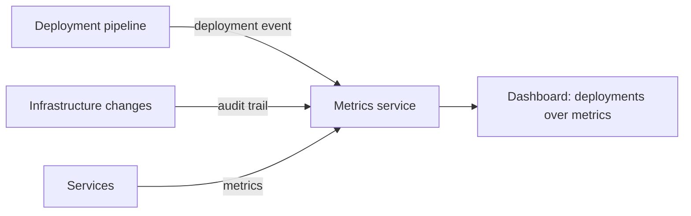

# Log Deployments and Changes

## Description

Problems in production often appear right after a change. The pattern consists of recording every deployment and every change made to production (service versions, configuration, infrastructure) so those events can be correlated with changes in behavior.

A common technique is for the deployment tool to publish a pseudo-metric each time a service is deployed. Displayed alongside the other metrics on dashboards, it lets you link a change in application behavior to a specific deployment. Logging infrastructure API calls, such as AWS CloudTrail, also serves this purpose.

## Problems it solves

- Understanding application behavior and diagnosing problems tied to recent changes
- Quickly answering the question "what changed?" during an incident

## When to use

- Environments with frequent deployments and several teams changing production
- When you need to correlate incidents with versions and configuration changes

### When to avoid

- Systems where changes are rare and already documented by other means

## Trade-offs

| Benefit | Cost / Risk |
| --- | --- |
| Easy correlation between deployments, changes, and problems, speeding up resolution | Requires integrating pipelines and tools to emit the events consistently |
| Context visible on dashboards | Changes made outside the instrumented tools aren't recorded |

- The original page doesn't list any significant drawbacks. In practice, the benefit depends on covering every path by which changes are made.

## Diagram

Deployment and change events are published alongside the metrics, and the dashboard overlays both for correlation.

## Related patterns

- [Application Metrics](/architecture/microservices/observability/application-metrics) — the deployment is published as a pseudo-metric next to the metrics
- [Audit Logging](/architecture/microservices/observability/audit-logging) — records user actions, whereas this one records changes to the environment
- [Log Aggregation](/architecture/microservices/observability/log-aggregation) — change events can also be sent to the centralized logs
- [Service Deployment Platform](/architecture/microservices/deployment/service-deployment-platform) — the deployment platform is a natural source of the events

## Reference

- [Pattern page on microservices.io](https://microservices.io/patterns/observability/log-deployments-and-changes.html)
