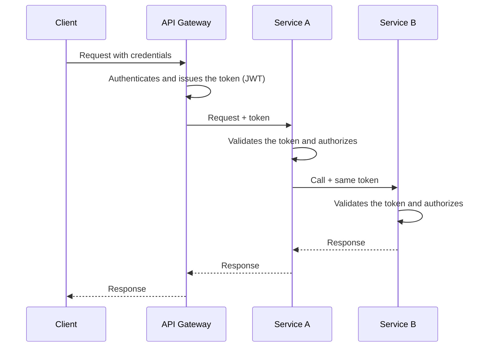

# Access Token

## Description

Access Token is the pattern in which the identity of the requester is carried by a secure token, instead of each service re-authenticating the client. The API Gateway authenticates the request at the edge and issues (or forwards) a token, typically a signed JSON Web Token (JWT), containing the requester's identity and, usually, their permissions or scopes.

This token accompanies the request to every service that processes it. When a service needs to call another to complete the operation, it propagates the same token, so the whole chain of calls knows the original requester. Each service validates the token's signature and validity locally and decides whether the operation is allowed.

## Problems it solves

- How to communicate the requester's identity to the services that handle the request, without each one redoing the authentication.
- Services need to verify that the user is authorized to perform an operation.
- Chained calls between services lose the original user's context if the identity isn't propagated.

## When to use

- A microservices architecture with an API Gateway as the single entry point that authenticates requests.
- Services that make authorization decisions based on the user's identity, roles, or scopes.
- Calls between services that need to preserve the original requester's context.

## When to avoid

- Small or monolithic systems, where traditional server-side sessions are enough.
- Scenarios that require immediate, universal access revocation, if there's no mechanism for it (short-lived tokens, a revocation list, or introspection).
- When there's no reliable infrastructure to manage signing keys and rotate them.

## Trade-offs

| Benefit | Cost / Risk |
| --- | --- |
| The requester's identity is propagated securely across the whole system | A stolen token can be reused until it expires |
| Services verify authorization without querying a session server on every call | Revocation before expiry is hard with self-contained tokens |
| Services hold no session state, which makes horizontal scaling easier | Tokens with many permissions get large and increase the size of every request |
| Authentication centralized at the edge | Managing signing keys, rotation, and clock synchronization |

- Use short-lived tokens and refresh to limit the window for abuse.
- Validate signature, issuer, audience, and expiry in each service; don't rely on the internal network alone.
- Avoid putting sensitive data in the payload, since a JWT is encoded, not encrypted.
- Log the token or user identifier to make tracing easier.

## Diagram

The gateway authenticates the client once and issues the token; each service validates the token locally and passes it on in subsequent calls.

## Related patterns

- [API Gateway](/architecture/microservices/external-api/api-gateway) — authenticates the request at the edge and issues the token that is passed on to the services
- [Federated Identity](/architecture/cloud-design-patterns/security-and-access/federated-identity) — delegates authentication to an external identity provider, which normally issues the token used here
- [Gatekeeper](/architecture/cloud-design-patterns/security-and-access/gatekeeper) — the gateway or intermediary that validates requests before they reach the protected services
- [Valet Key](/architecture/cloud-design-patterns/security-and-access/valet-key) — also uses a restricted access token, but to grant limited, temporary access to a specific resource

## Reference

- [Pattern page on microservices.io](https://microservices.io/patterns/security/access-token.html)
