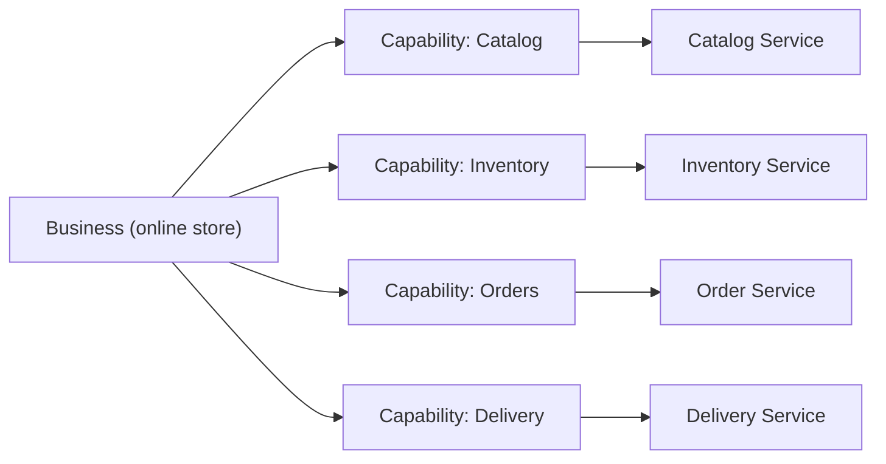

# Decompose by Business Capability

## Description

Decompose by Business Capability defines services from business capabilities, that is, the things the organization does to generate value, such as order management, catalog, inventory, or delivery. A capability usually corresponds to a business object and can be organized into multi-level hierarchies.

Because capabilities change slowly, the resulting architecture is stable. Each service exposes an API that hides its implementation, and most changes affect only one service, which enables small, autonomous teams oriented around business value. A good starting point is the organizational structure and the high-level domain model.

## Problems it solves

- How to decompose a large application into services in a way that stays stable over time
- Services need to be cohesive and loosely coupled, with APIs that hide the implementation
- Changes should generally touch a single service, avoiding coordination between teams
- Each service should be testable and small enough for a team of about 6 to 10 people

## When to use

- When designing or refactoring toward a microservices architecture with autonomous teams
- When the organization has business capabilities that are clearly identifiable and relatively stable

### When to avoid

- In small applications, where decomposition only adds complexity
- When the understanding of the business is still shallow and there's no way to iterate on the boundaries

## Trade-offs

| Benefit | Cost / Risk |
| --- | --- |
| Stable architecture, since capabilities change little | Requires real understanding of the business |
| Cohesive, loosely coupled services | Identifying capabilities is an iterative, error-prone process |
| Cross-functional teams oriented around business value | Capabilities of the wrong granularity produce services that are too large or coupled |

- Boundaries should be revisited as the understanding of the business evolves.
- Flows that cross capabilities require collaboration between services (sagas, events).

## Diagram

Each business capability gives rise to a service with its own responsibility.

## Related patterns

- [Decompose by Subdomain](/architecture/microservices/service-boundaries/decompose-by-subdomain) — an alternative approach based on DDD subdomains
- [Service per Team](/architecture/microservices/service-boundaries/service-per-team) — defines the relationship between the resulting services and teams
- [Microservice Architecture](/architecture/microservices/architectural-style/microservice-architecture) — the architectural style that creates the need to decompose

## Reference

- [Pattern page on microservices.io](https://microservices.io/patterns/decomposition/decompose-by-business-capability.html)
