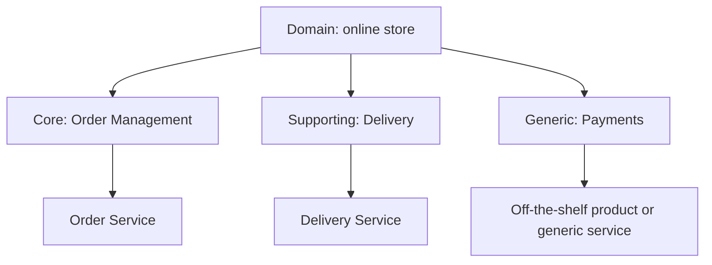

# Decompose by Subdomain

## Description

Decompose by Subdomain defines services from Domain-Driven Design (DDD) subdomains, which represent the distinct areas of the business. Each subdomain tends to have its own model and vocabulary, which provides natural boundaries for services.

Subdomains are classified into three types: core (the competitive differentiator and the most valuable part), supporting (related to the business but not a differentiator, which can be built in-house or outsourced), and generic (not specific to the business, ideally served by off-the-shelf software). This classification also guides where to invest engineering effort.

## Problems it solves

- How to decompose an application into services with a stable architecture
- Grouping what changes together (Common Closure Principle), so that a change affects a single service
- Keeping services cohesive, loosely coupled, testable, and with APIs that hide the implementation
- Sizing services for autonomous teams of about 6 to 10 people

## When to use

- When the domain is complex and benefits from DDD modeling
- When you want to distinguish what to build (core) from what to buy or outsource (generic)

### When to avoid

- In simple domains, where modeling subdomains is a disproportionate effort
- Without access to domain experts to validate the boundaries

## Trade-offs

| Benefit | Cost / Risk |
| --- | --- |
| Stable architecture, since subdomains change little | Requires deep understanding of the business |
| Cohesive services aligned with business value | Identifying subdomains is iterative |
| Clarity about what is core, supporting, and generic | Poorly defined boundaries lead to coupling between services |

- The high-level domain model and the organizational structure are good starting points.
- Integrations between subdomains may require translation layers.

## Diagram

The domain is divided into subdomains of distinct types, each mapped to a suitable service or solution.

## Related patterns

- [Decompose by Business Capability](/architecture/microservices/service-boundaries/decompose-by-business-capability) — an alternative approach based on business capabilities
- [Service per Team](/architecture/microservices/service-boundaries/service-per-team) — assigns the identified services to teams
- [Anti-Corruption Layer](/cloud/cloud-design-patterns/integration-and-modernization/anti-corruption-layer) — protects a subdomain's model when integrating with others
- [Microservice Architecture](/architecture/microservices/architectural-style/microservice-architecture) — the architectural style that motivates the decomposition

## Reference

- [Pattern page on microservices.io](https://microservices.io/patterns/decomposition/decompose-by-subdomain.html)
