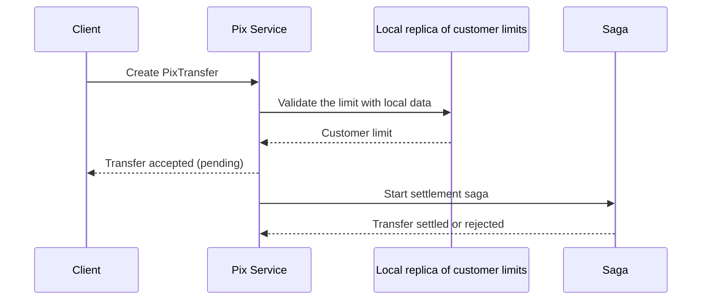

# Self-contained Service

## Description

Self-contained Service designs a service to respond to a synchronous request without having to wait for any other service. This keeps the operation's availability and latency from depending on a chain of remote calls.

There are two ways to achieve this: absorb the needed functionality as a module inside the service itself (for example, merging the order and restaurant services), or collaborate asynchronously, using sagas to maintain consistency and CQRS to keep a local replica of data owned by other services. That way, the service accepts the request, validates it against local data, and completes the rest asynchronously, leaving the operation in a pending state until confirmation.

## Problems it solves

- A request often spreads across several services, making its handling dependent on all of them
- Operations need high availability and low response time
- Overall availability drops with each service invoked synchronously, since it is roughly the product of the individual availabilities
- Retries increase the chance of success, but also latency

## When to use

- In critical, high-availability, low-latency operations that currently depend on several synchronous calls
- When other services' data can be replicated locally and eventual consistency is acceptable

## When to avoid

- When the operation requires strong, immediate consistency with other services' data
- When the cost of CQRS and sagas outweighs the availability gain

## Trade-offs

| Benefit | Cost / Risk |
| --- | --- |
| Higher availability of the operation | Additional cost and complexity of CQRS and sagas |
| Lower response time | A less direct API: the client may need to query the final result later |
| Fewer runtime dependencies | A larger service, if the functionality is absorbed |

- Eventual consistency between replicas and source data.
- Observability of the asynchronous flow is essential for tracking the state of sagas.

## Diagram

The service responds without calling other services; settlement completes asynchronously through the saga. The source illustrates the pattern with orders and restaurants.

## Related patterns

- [Saga](/architecture/cloud-design-patterns/distributed-coordination/saga) — maintains data consistency asynchronously
- [CQRS](/architecture/cloud-design-patterns/data-management/cqrs) — keeps local replicas of other services' data
- [Command-side Replica](/architecture/microservices/service-collaboration/command-side-replica) — a local replica used to validate commands without remote calls
- [Microservice Architecture](/architecture/microservices/architectural-style/microservice-architecture) — the context that creates the need for the pattern

## Reference

- [Pattern page on microservices.io](https://microservices.io/patterns/decomposition/self-contained-service.html)
