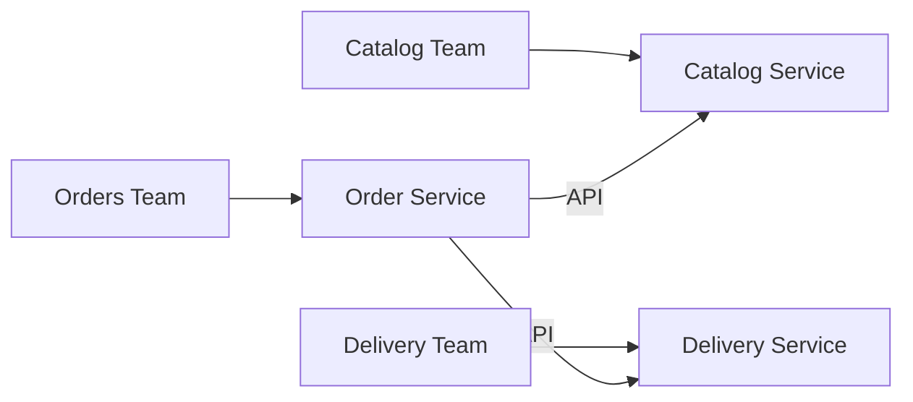

# Service per Team

## Description

Service per Team establishes that each service belongs to exactly one team, which has sole responsibility for changing it. Ideally, a team owns a single service, whose code fits within the cognitive capacity of its members.

The pattern starts from Conway's law: the architecture reflects the organization's communication structure. High-performing organizations have small (about 5 to 9 people), long-lived, autonomous, cross-functional, loosely coupled teams, and that calls for an equally decoupled architecture. A team should maintain several services only when there's a proven need, such as reducing lead time or improving scalability and fault tolerance.

## Problems it solves

- What the relationship between teams and services is
- Keeping teams small, autonomous, and loosely coupled
- Keeping a team's code within its cognitive capacity
- Balancing fine granularity (maintenance, testing, deployment) against the complexity it brings

## When to use

- When adopting microservices in an organization with small, long-lived teams
- When you want delivery autonomy and clear long-term responsibility for each service

### When to avoid

- When there aren't teams stable enough to take on lasting ownership
- When the same service inevitably needs to be changed continuously by several teams

## Trade-offs

| Benefit | Cost / Risk |
| --- | --- |
| Autonomy and little coordination between teams | Teams may not align with the features the end user sees |
| Minimum number of services needed | Features that cross services require collaboration between teams |
| Long-term ownership tends to raise code quality | Risk of silos and of depending on a few people |

- Define clear, versioned API contracts between teams.
- Revisit the split when the organization or the domain changes.

## Diagram

Each team owns a service and the services communicate through APIs, keeping coupling low.

## Related patterns

- [Decompose by Business Capability](/architecture/microservices/service-boundaries/decompose-by-business-capability) — helps identify the services to assign to teams
- [Decompose by Subdomain](/architecture/microservices/service-boundaries/decompose-by-subdomain) — another way to identify services aligned with the domain
- [Microservice Architecture](/architecture/microservices/architectural-style/microservice-architecture) — the architectural style that creates the need for the pattern

## Reference

- [Pattern page on microservices.io](https://microservices.io/patterns/decomposition/service-per-team.html)
