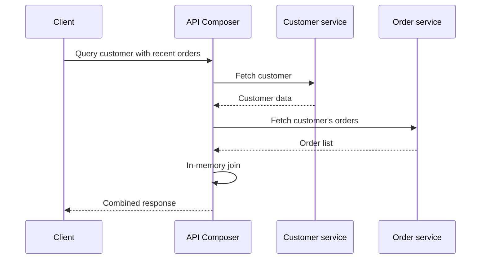

# API Composition

## Description

In an application with microservices and Database per Service, the data is spread across private databases, and queries that combine information from several services are no longer a simple *join*. API Composition solves this with a component called the *API Composer*, which invokes the services that hold the data and performs an in-memory *join* over the results.

In general, the composer role is taken on by an API Gateway, but it can be a dedicated service or a *backend for frontend*. For example, to list a customer with their recent orders, the composer queries the customer service, then the order service, and assembles the combined response.

**Relationship with Gateway Aggregation:** Gateway Aggregation, from the cloud pattern catalog, is essentially the same technique applied at the gateway: aggregating several backend calls into a single client request. The difference is in the focus. Gateway Aggregation is an edge pattern, focused on reducing the *chattiness* between client and services, and it doesn't discuss the origin of the data fragmentation. API Composition is a microservices data pattern, motivated by Database per Service, that specifically addresses how to implement queries and *joins* across private databases, and it can run inside the gateway or in any other service. Put another way: the gateway is a place where composition happens; composition is the query strategy.

## Problems it solves

- How to implement queries that need data from several services when each service owns a private database.
- Avoiding direct access to other services' databases or building a dedicated replica for simple queries.
- Reducing the number of calls the client has to make to assemble a complete view.

## When to use

- Queries that combine a few services and small or paginated data sets.
- When the eventual consistency of a derived view (CQRS) would be an unnecessary cost.
- When you want the simplest approach to serve the query.

## When to avoid

- Queries that require *joins* over large volumes of data, which become inefficient in memory.
- When the composer's availability is affected by several services called in series or in parallel and there's no tolerance for partial failures.
- When the same query is very frequent and deserves a materialized view with CQRS.

## Trade-offs

| Benefit | Cost / Risk |
| --- | --- |
| A simple approach for querying data across services | In-memory *joins* can be inefficient over large data sets |
| Data is always read from the source, with no replica lag | Response latency depends on the slowest service |
| No additional event and view infrastructure | Combined availability is lower than that of each service on its own |
| Reuses the services' existing APIs | Each query generates several calls, increasing load and network traffic |

- **Partial failures:** define the behavior when one of the services fails (partial response, *fallback*, total failure) and use *circuit breaker* and *timeouts*.
- **Parallelism:** call independent services in parallel to reduce total latency.
- **Boundary:** keep the composition logic thin; business rules should remain in the services.

## Diagram

The composer calls each service that owns the data, joins the results in memory, and returns a single response to the client.

## Related patterns

- [Database per Service](/architecture/microservices/service-collaboration/database-per-service) — creates the need for this pattern.
- [CQRS](/architecture/cloud-design-patterns/data-management/cqrs) — an alternative approach, with materialized views maintained by events.
- [API Gateway](/architecture/microservices/external-api/api-gateway) — the place where composition is usually performed.
- [Gateway Aggregation](/architecture/cloud-design-patterns/gateways-and-edge/gateway-aggregation) — the equivalent cloud pattern at the edge, focused on reducing client calls, without addressing the origin of the data fragmentation.
- [Backend for Front-End](/architecture/cloud-design-patterns/gateways-and-edge/backends-for-frontends) — another common place to host the composition.
- [Circuit Breaker](/architecture/cloud-design-patterns/resiliency/circuit-breaker) — protects the composer against slow or unavailable services.

## Reference

- [Pattern page on microservices.io](https://microservices.io/patterns/data/api-composition.html)
