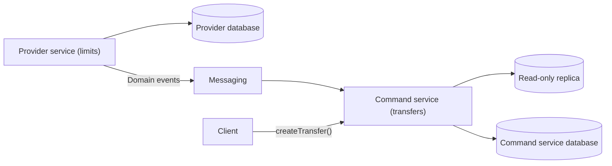

# Command-side Replica

## Description

In an architecture with Database per Service, a service that executes a command often needs data that belongs to another service. For example, the transfer service, when creating a transfer, needs the customer's limits, maintained by a limits service, to validate the operation. Querying the other service at runtime, synchronously or as a step of a saga, increases network traffic and creates a runtime dependency.

Command-side Replica solves this by keeping, inside the command's service, a read-only replica of the provider's data. The replica is updated by subscribing to domain events published by the provider service. The pattern has three elements: the command service, the provider service (the data owner), and the replica database.

Structurally, it's the same mechanism as CQRS: a derived copy fed by events. The difference is the purpose, since here the replica serves the write side (the command), not read queries.

## Problems it solves

- How a service that implements a command obtains data that belongs to another service without calling it on every execution.
- Reducing runtime coupling, which affects the command's availability and latency.
- Reducing network round trips and the transfer of large volumes of data per call.
- The ability to use local ACID in the command, instead of depending on sagas or distributed consistency, by querying the local replica.

## When to use

- When the command needs reference data from another service at high frequency (catalogs, menus, prices).
- When the provider shouldn't be on the command's critical path for availability or performance reasons.
- When reading slightly stale data is acceptable for the business rule.

## When to avoid

- When the data must always be current and replica lag isn't tolerable.
- When the replicated data is regulated (for example, personal data), which widens the command service's security and compliance obligations.
- When the provider would produce a very high volume of events or the data structure is complex and unstable, creating design coupling.
- When a direct query to the provider, with caching, already works well.

## Trade-offs

| Benefit | Cost / Risk |
| --- | --- |
| Simpler, more efficient command, with no calls to the provider | Complexity: the command service maintains the replica and the provider must publish events |
| Lower runtime coupling and better availability | Greater design coupling: the consumer needs to understand the data's structure and lifecycle |
| The replica can use the technology stack best suited to the command | The replica may be stale (eventual consistency) |
| The provider can have lower performance and availability requirements | The command service's pipeline may get slower because it has to test the replica |

- **Team autonomy:** the need to align events and contracts increases coordination between teams.
- **Regulation:** replicas holding personal data widen the security and compliance surface.
- **Idempotency:** event consumption must tolerate duplicates and reordering.

## Diagram

The command service subscribes to the provider's events to maintain the local replica, which it uses to validate the command without calling the provider. The source illustrates the pattern with orders and restaurants.

## Related patterns

- [Database per Service](/architecture/microservices/service-collaboration/database-per-service) — creates the need for this pattern.
- [Domain Event](/architecture/microservices/service-collaboration/domain-event) — generates the events that keep the replica up to date.
- [CQRS](/architecture/cloud-design-patterns/data-management/cqrs) — structurally identical, but focused on reads.
- [Saga](/architecture/cloud-design-patterns/distributed-coordination/saga) — an alternative when the data is obtained as a step of the saga.
- [Materialized View](/architecture/cloud-design-patterns/data-management/materialized-view) — a precomputed view, a concept close to that of the replica.
- [Idempotent Consumer](/architecture/cloud-design-patterns/messaging/idempotent-consumer) — needed to consume events safely.

## Reference

- [Pattern page on microservices.io](https://microservices.io/patterns/data/command-side-replica.html)
