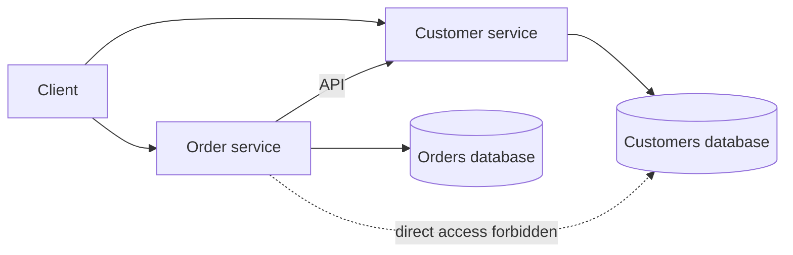

# Database per Service

## Description

In the Database per Service pattern, each service's persistent data is private to it and can only be accessed through its API. A service's transactions involve only its own database, which is treated as part of the service's internal implementation, invisible to the others.

Privacy can be achieved in different ways, with increasing overhead: private tables inside a shared database, one *schema* per service, or one database server per service (suitable, for example, for very high-throughput services). Regardless of the option, it's advisable to put enforcement barriers in place, such as a database user with permissions restricted per service, to stop developers from bypassing the API and reading another service's data directly.

This pattern is the foundation of service autonomy, but it comes at the cost of losing ACID transactions and *joins* across services. That's why it usually comes with Saga (for transactions) and API Composition or CQRS (for queries).

## Problems it solves

- Coupling between services through the data schema, which prevents independent development, deployment, and scaling.
- The need to choose the storage technology best suited to each service (relational, document, graph, full-text search).
- The need to replicate and partition (*shard*) each service's database according to its load, without affecting the others.
- Runtime interference between services, such as long-running locks that block tables used by others.

## When to use

- In microservices architectures where team autonomy and independent deployment are a priority.
- When services have quite different storage or scaling needs.
- When you accept handling consistency between services as eventual, with sagas and derived views.

### When to avoid

- Small or monolithic systems, where a single ACID transaction solves the business rules more simply.
- When business invariants constantly span several services, signaling that the service boundaries may be poorly defined.
- When the team isn't mature enough to operate several databases and deal with eventual consistency.

## Trade-offs

| Benefit | Cost / Risk |
| --- | --- |
| Low coupling: changes to one database don't affect the other services | Transactions across services become hard and require sagas |
| Freedom to use the right type of database for each service (polyglot) | Queries with *joins* across services are no longer trivial |
| Independent scaling, replication, and *sharding* per service | More databases, of different technologies, to operate, monitor, and back up |
| Fault and performance isolation between services | Duplicated data and eventual consistency between services |

- **Distributed transactions:** usually avoided because of CAP theorem limitations and because many NoSQL databases don't support them.
- **Enforcement:** without technical barriers (per-service credentials and permissions), the privacy rule tends to get violated.
- **Observability and governance:** backup, schema migration, and monitoring need to be standardized across different technologies.

## Diagram

Each service accesses only its own database. When it needs data from another service, the Order service uses the Customer service's API, never its database.

## Related patterns

- [Microservice Architecture](/architecture/microservices/architectural-style/microservice-architecture) — the architectural style that creates the need for this pattern.
- [Saga](/architecture/cloud-design-patterns/distributed-coordination/saga) — provides eventually consistent transactions across services.
- [API Composition](/architecture/microservices/service-collaboration/api-composition) — a simple way to implement queries that cross services.
- [CQRS](/architecture/cloud-design-patterns/data-management/cqrs) — maintains views that combine data from several services.
- [Shared Database](/architecture/microservices/service-collaboration/shared-database) — the alternative (and anti-pattern) of sharing a single database.
- [Command-side Replica](/architecture/microservices/service-collaboration/command-side-replica) — locally replicates another service's data for commands.

## Reference

- [Pattern page on microservices.io](https://microservices.io/patterns/data/database-per-service.html)
