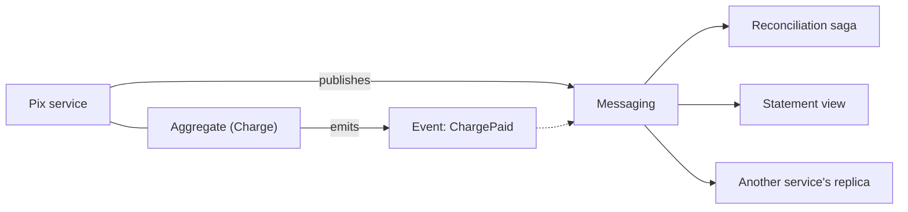

# Domain Event

## Description

A *Domain Event*, a concept from Domain-Driven Design, is a business-relevant fact that occurred in the domain, such as `OrderCreated` or `CreditReserved`. In the pattern, a service's business logic is structured into aggregates, and each aggregate emits a domain event whenever it is created or changed. The service publishes these events so other services can consume them.

Events are named in the past tense, immutable, and carry the data consumers need to react without having to query the emitter. They are the input for updating CQRS views, maintaining local replicas, and driving choreographed sagas.

In DDD, the Domain Event is first and foremost a fact about the domain: something that happened and that business experts consider relevant, named using the ubiquitous language. It is produced by the [Aggregate](/design/ddd/building-blocks/aggregate) and can be handled within the same context, to propagate eventual consistency between aggregates, or published to other contexts as an integration contract.

The pattern itself defines what to publish; reliable publication (atomic with the database update) is handled by patterns such as Transactional Outbox or Event Sourcing.

## Problems it solves

- How a service publishes an event when it updates its data.
- How to let other services react to changes without direct coupling to the emitter.
- How to feed CQRS views, replicas, and choreographed saga steps with reliable facts from the domain.

## When to use

- When other services need to react to state changes, as in choreographed sagas.
- When derived views or replicas need to be kept up to date.
- When the business logic is already modeled with aggregates.

## When to avoid

- When no other component needs to be notified of the changes.
- When there's no messaging infrastructure and no way to guarantee publication atomic with the database write.
- When the granularity of the events tends to expose internal details of the model, creating coupling.

## Trade-offs

| Benefit | Cost / Risk |
| --- | --- |
| Low coupling between emitter and consumers | Events become a public contract that needs to be versioned |
| Foundation for CQRS, replicas, and choreographed sagas | Eventual consistency between emitter and consumers |
| Language aligned with the business domain | Reliable publication requires Transactional Outbox or Event Sourcing |
| New consumers can be added without changing the emitter | Event-based flows are harder to trace and debug |

- **Atomicity:** updating the database and publishing the event must be atomic; otherwise, data and events diverge.
- **Duplicates and ordering:** delivery is usually *at least once*, requiring idempotent consumers and attention to per-aggregate ordering.
- **Content:** events that are too lean force queries back to the emitter; ones that are too fat leak internal details.

## Diagram



The aggregate emits the event, the service publishes it, and different consumers react to it, each in its own way. The source illustrates the pattern with orders.

## Example

A Pix charge (`PixCharge`) records the `ChargePaid` event when it is paid; after persisting the aggregate, the service publishes the accumulated events.

```java
public record ChargePaid(String chargeId, String txid, long amountCents, Instant occurredAt) {}

public class PixCharge {
    private final String id;
    private final String txid;
    private final long amountCents;
    private boolean paid;
    private final List<Object> events = new ArrayList<>();

    public PixCharge(String id, String txid, long amountCents) {
        this.id = id;
        this.txid = txid;
        this.amountCents = amountCents;
    }

    public void markPaid() {
        if (paid) return;
        paid = true;
        events.add(new ChargePaid(id, txid, amountCents, Instant.now()));
    }

    public List<Object> pullEvents() {
        List<Object> copy = List.copyOf(events);
        events.clear();
        return copy;
    }
}

public class PixChargeService {
    @Transactional
    public void settle(String chargeId) {
        PixCharge charge = charges.findById(chargeId);
        charge.markPaid();
        charges.save(charge);
        charge.pullEvents().forEach(publisher::publish); // e.g., via Transactional Outbox
    }
}
```

## Related patterns

- [Aggregate](/design/ddd/building-blocks/aggregate) — the aggregate is the natural source of domain events.
- [Saga](/architecture/cloud-design-patterns/distributed-coordination/saga) — choreographed sagas depend on domain events.
- [CQRS](/architecture/cloud-design-patterns/data-management/cqrs) — read views are updated by these events.
- [Command-side Replica](/architecture/microservices/service-collaboration/command-side-replica) — local replicas are maintained by the events.
- [Event Sourcing](/architecture/cloud-design-patterns/data-management/event-sourcing) — can be used to generate and publish domain events.
- [Transactional Outbox](/architecture/microservices/transactional-messaging/transactional-outbox) — publishes the events atomically with the database transaction.
- [Messaging](/architecture/microservices/communication-styles/messaging) — the communication style used to distribute the events.
- [Publisher-Subscriber](/architecture/cloud-design-patterns/messaging/publisher-subscriber) — the model for distributing events to multiple consumers.

## Reference

- [DDD Reference, Eric Evans (2015)](https://www.domainlanguage.com/ddd/reference/)
- [Pattern page on microservices.io](https://microservices.io/patterns/data/domain-event.html)
- [Domain Event, Martin Fowler](https://martinfowler.com/eaaDev/DomainEvent.html)
