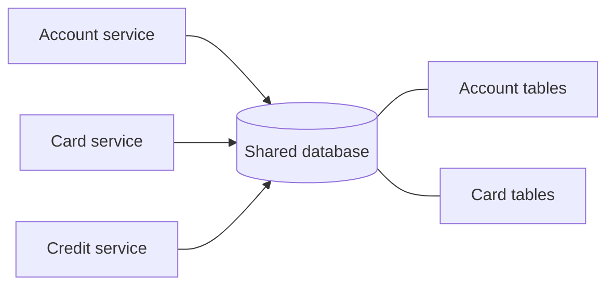

# Shared Database

## Description

In the Shared Database pattern, all services use a single database. Each service can read and write directly to data belonging to other services, taking advantage of local ACID transactions. For example, the order service can run a single transaction that reads the customer's credit limit and total open orders and then inserts the new order, with the database guaranteeing that the limit isn't exceeded, even with concurrent orders.

In microservices, this approach is generally considered an anti-pattern, because the data schema becomes an implicit contract between all services. It's described in the catalog as the alternative that contrasts with Database per Service, and it's useful above all for understanding what is lost (and what is gained) by adopting private databases.

From the Enterprise Integration Patterns perspective (Hohpe and Woolf), Shared Database is one of the four integration styles: applications exchange information by writing to a single database. Since they all see the same data at almost the same time, consistency is high, transaction management handles concurrent updates, and errors are easier to trace. The biggest difficulty is designing a single schema that serves several applications well, and political pressure from teams that don't want to wait for a unified schema often leads to fragmentation.

## Problems it solves

- Business invariants that span services (such as respecting the credit limit when creating an order) require strong consistency, and ACID transactions solve this simply.
- Queries that cross data from several services (credit availability, customers in a region with their recent orders) are solved with ordinary *joins*.
- Operating a single database is simpler than operating several.

## When to use

- In small applications, or ones transitioning from a monolith, where few teams share the same domain.
- When strong consistency between the data is a non-negotiable requirement and service autonomy is secondary.

## When to avoid

- When independent deployment and evolution of services are goals of the architecture.
- When services have very different storage or scaling requirements.
- When several teams change the schema frequently.

## Trade-offs

| Benefit | Cost / Risk |
| --- | --- |
| Familiar ACID transactions guarantee data consistency | Development-time coupling: schema changes require coordination among all teams that use the tables |
| A single database is simpler to operate | Runtime coupling: a long transaction in one service can lock tables and stall another |
| Queries with *joins* across domains are trivial | A single database may not meet the storage needs of all services |

- **Scale:** the shared database becomes a single point of contention and failure; replication and *sharding* affect all services at the same time.
- **Evolution:** the schema becomes hard to change, and data ownership is ambiguous.

## Diagram

All services read and write to the same database, which simplifies transactions and queries but creates strong coupling through the shared schema. The source illustrates the pattern with orders, customers, and payments.

## Related patterns

- [Database per Service](/architecture/microservices/service-collaboration/database-per-service) — the main alternative, in which each service owns its data privately.
- [Microservice Architecture](/architecture/microservices/architectural-style/microservice-architecture) — the architectural context in which the database decision arises.
- [Monolithic Architecture](/architecture/microservices/architectural-style/monolithic-architecture) — a style in which a single database is natural.
- [File Transfer](/architecture/eip/integration-styles/file-transfer) — a batch integration style that exchanges data through files instead of a common database.
- [Remote Procedure Invocation](/architecture/microservices/communication-styles/remote-procedure-invocation) — a style in which each application keeps its data and exposes it through calls.
- [Messaging](/architecture/microservices/communication-styles/messaging) — an asynchronous style that avoids the shared schema.

## Reference

- [Pattern page on microservices.io](https://microservices.io/patterns/data/shared-database.html)
- [Pattern page on Enterprise Integration Patterns](https://www.enterpriseintegrationpatterns.com/SharedDataBaseIntegration.html)
