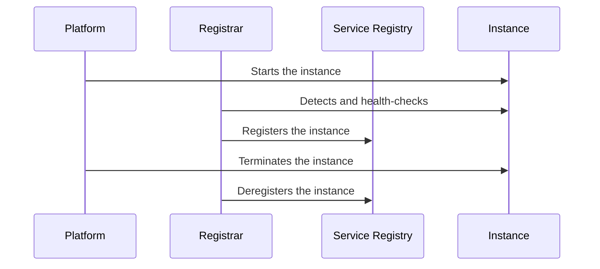

# 3rd Party Registration

## Description

In 3rd Party Registration, a separate component, the registrar, takes care of registering each instance in the Service Registry when it starts and removing it when it shuts down. The service doesn't manage its own registry entry.

The registrar can watch the deployment platform or run health checks, and register or remove instances based on the result.

## Problems it solves

- Registering instances at startup and removing them at shutdown.
- Removing failed (crashed) instances from the registry.
- Removing running instances that can't serve requests.

## When to use

- When you want to keep the service code free of registration logic.
- Polyglot environments or deployment platforms that already provide the registrar.

### When to avoid

- When you need to know the instance's fine-grained state and the registrar only sees whether it's running.
- When operating an extra critical component isn't feasible.

## Trade-offs

| Benefit | Cost / Risk |
| --- | --- |
| Simpler service code, decoupled from the registry | The registrar may know only the coarse state (running or not) |
| The registrar can run health checks and act on the result | One more component to install and maintain, unless it's part of the infrastructure |

- The registrar is critical and needs high availability.
- Some registrars, such as Netflix Prana, mitigate the limitation with health checks.

## Diagram

An external registrar watches the instances and maintains the registry.

## Related patterns

- [Service Registry](/architecture/microservices/service-discovery/service-registry) — where the registrar keeps the instances
- [Self Registration](/architecture/microservices/service-discovery/self-registration) — an alternative in which the instance registers itself
- [Client-side Discovery](/architecture/microservices/service-discovery/client-side-discovery) and [Server-side Discovery](/architecture/microservices/service-discovery/server-side-discovery) — consumers of the registry
- [Health Check API](/architecture/cloud-design-patterns/resiliency/health-endpoint-monitoring) — used by the registrar to check health

## Reference

- [Pattern page on microservices.io](https://microservices.io/patterns/3rd-party-registration.html)
