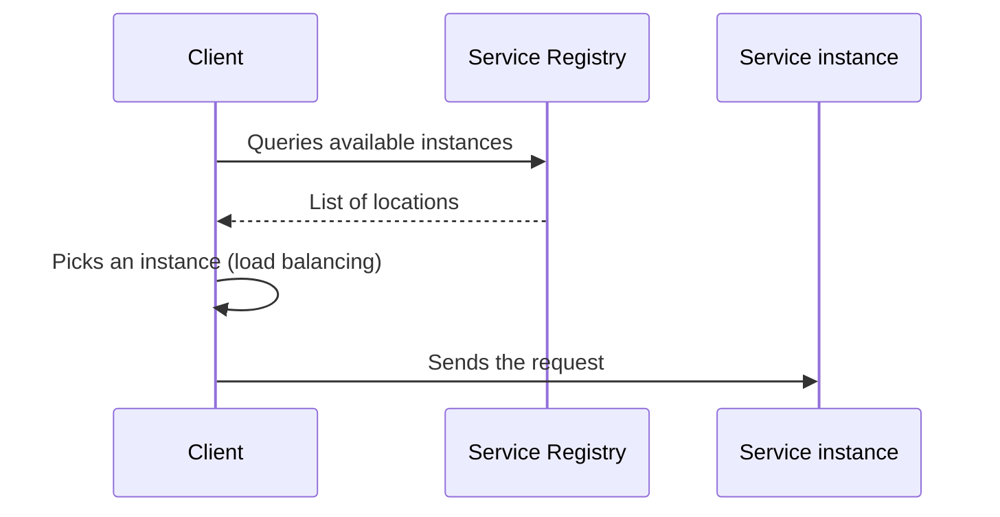

# Client-side Discovery

## Description

In Client-side Discovery, the client of a service (another service or an API gateway) is responsible for finding where the available instances are. Before sending a request, it queries the Service Registry, which keeps the location of all instances, and picks one, normally applying a load-balancing algorithm such as round-robin.

This logic is generally provided by a microservice chassis or client library, so the business code doesn't need to know about it. The client usually keeps a local cache of the instance list to reduce registry queries.

## Problems it solves

- Each instance exposes a remote API (HTTP/REST, Thrift, etc.) on a specific host and port.
- The number and location of instances change dynamically.
- VMs and containers usually get dynamic IP addresses.
- The number of instances varies with load, for example in autoscaling groups.
- Clients need to find ephemeral instances without known fixed addresses.

## When to use

- Dynamic environments (containers, VMs, autoscaling) where instances change frequently.
- When you want fewer network hops and fine-grained control of load balancing on the client.
- When a standardized chassis or library already exists for the language(s) in use.

### When to avoid

- Polyglot environments where implementing discovery in each language is expensive.
- When the platform already offers transparent discovery and routing (use Server-side Discovery).

## Trade-offs

| Benefit | Cost / Risk |
| --- | --- |
| Fewer components and fewer network hops than server-side discovery | Client coupled to the Service Registry |
| Flexible load balancing decided by the client | Discovery logic must be implemented for each language/framework |

- Cached data can become stale if the registry fails or is slow to reflect changes.
- Helper proxies (such as Netflix Prana) can serve non-JVM clients over HTTP.

## Diagram

The client queries the registry, picks an instance, and calls it directly.

## Related patterns

- [Service Registry](/architecture/microservices/service-discovery/service-registry) — the source of the locations the client queries
- [Server-side Discovery](/architecture/microservices/service-discovery/server-side-discovery) — an alternative in which a router does the discovery
- [Microservice Chassis](/architecture/microservices/cross-cutting-concerns/microservice-chassis) — usually embeds the discovery logic
- [Self Registration](/architecture/microservices/service-discovery/self-registration) and [3rd Party Registration](/architecture/microservices/service-discovery/3rd-party-registration) — ways of populating the registry

## Reference

- [Pattern page on microservices.io](https://microservices.io/patterns/client-side-discovery.html)
