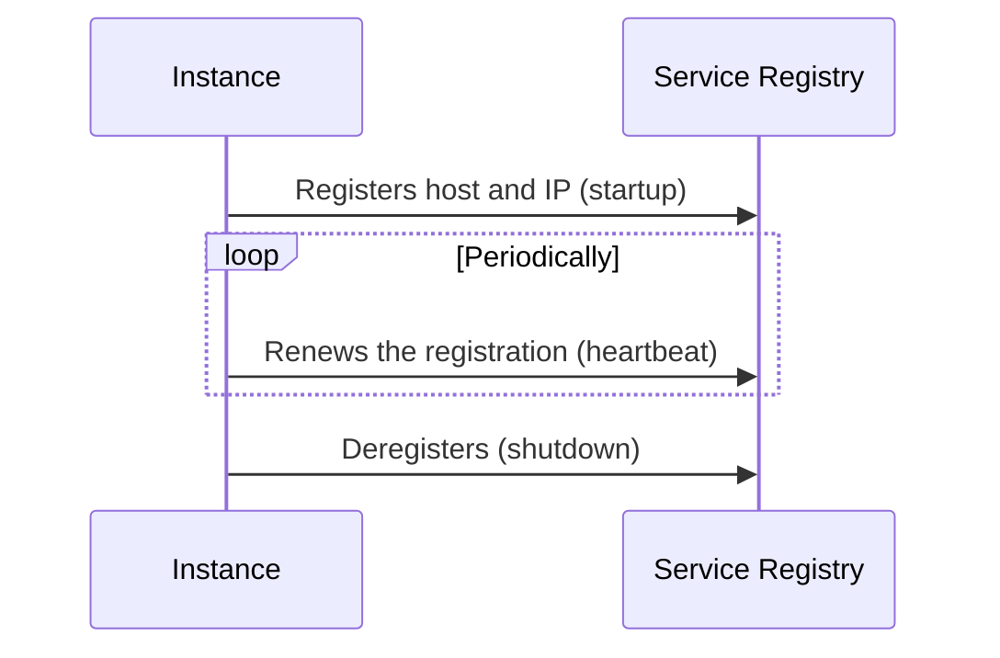

# Self Registration

## Description

In Self Registration, each service instance is responsible for registering itself in the Service Registry, supplying its host and IP address at startup. It then periodically renews the registration (heartbeat) to show it's alive and, on shutdown, removes itself.

Normally a microservice chassis or client library (for example, the Netflix Eureka client) implements this behavior.

## Problems it solves

- Registering instances at startup and removing them at shutdown.
- Removing failed (crashed) instances from the registry.
- Removing running instances that can't serve requests.

## When to use

- When the service already uses a chassis that implements registration.
- When the instance needs to expose richer states than UP/DOWN, such as STARTING or AVAILABLE.

## When to avoid

- Polyglot environments where replicating the logic in each language is costly.
- When you want to keep services decoupled from the registry (prefer 3rd Party Registration).

## Trade-offs

| Benefit | Cost / Risk |
| --- | --- |
| The instance knows its own state and can use a richer model than UP/DOWN | Couples the service to the Service Registry |
| No extra registration component | Registration logic in each language/framework |

- An instance that's alive but unable to serve often can't remove itself; heartbeat expiration is needed.

## Diagram

The instance itself manages its lifecycle in the registry.

## Related patterns

- [Service Registry](/architecture/microservices/service-discovery/service-registry) — where the instance registers
- [3rd Party Registration](/architecture/microservices/service-discovery/3rd-party-registration) — an alternative with an external registrar
- [Client-side Discovery](/architecture/microservices/service-discovery/client-side-discovery) and [Server-side Discovery](/architecture/microservices/service-discovery/server-side-discovery) — consumers of the registry
- [Microservice Chassis](/architecture/microservices/cross-cutting-concerns/microservice-chassis) — usually implements the registration

## Reference

- [Pattern page on microservices.io](https://microservices.io/patterns/self-registration.html)
