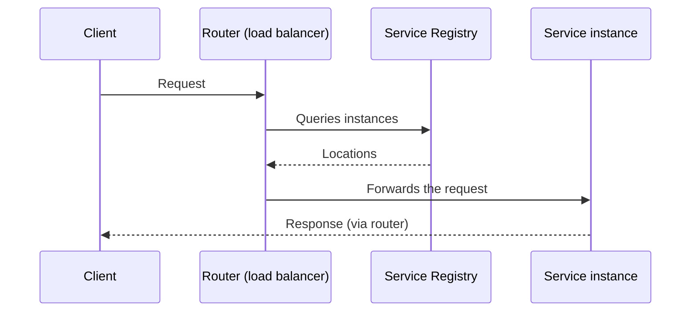

# Server-side Discovery

## Description

In Server-side Discovery, the client sends its requests to a router (also called a load balancer) at a well-known address. The router queries the Service Registry, which may be built into it, and forwards each request to an available instance.

This way, the discovery logic moves out of the client and into the infrastructure. Examples are the AWS Elastic Load Balancer and the per-host proxies in Kubernetes and Marathon.

## Problems it solves

- Each instance exposes a remote API (HTTP/REST, Thrift, etc.) on a specific host and port.
- The number and location of instances change dynamically.
- VMs and containers usually get dynamic IP addresses.
- The number of instances varies with load, for example in autoscaling groups.
- Clients shouldn't have to know the dynamic topology of instances.

## When to use

- When you want simple clients, with no discovery logic, across several languages.
- When the cloud or orchestration platform already provides the router.

### When to avoid

- When there's no ready-made infrastructure and operating one more replicated component isn't worth it.
- When the router doesn't support the required protocol (beyond TCP).

## Trade-offs

| Benefit | Cost / Risk |
| --- | --- |
| Simpler client code, with no discovery | One more component to install, configure, and replicate (outside platforms that provide it) |
| Provided out of the box by several platforms | More network hops than client-side discovery |

- The router is a critical point and needs high availability and capacity.
- It must support the protocols used by the services.

## Diagram

The client knows only the router; it queries the registry and picks the instance.

## Related patterns

- [Service Registry](/architecture/microservices/service-discovery/service-registry) — used by the router to locate instances
- [Client-side Discovery](/architecture/microservices/service-discovery/client-side-discovery) — the main alternative
- [Circuit Breaker](/cloud/cloud-design-patterns/resiliency/circuit-breaker) — the router can use it when invoking services
- [API Gateway](/architecture/microservices/external-api/api-gateway) — often acts as the entry router
- [Gateway Routing](/cloud/cloud-design-patterns/gateways-and-edge/gateway-routing) — routing requests to backend services

## Reference

- [Pattern page on microservices.io](https://microservices.io/patterns/server-side-discovery.html)
