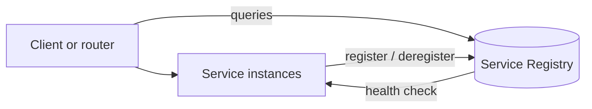

# Service Registry

## Description

The Service Registry is a database of services, their instances, and their locations. Instances register at startup and remove themselves at shutdown; clients or routers query the registry to find out which instances are available.

Optionally, the registry calls each instance's health check API to confirm it can serve requests. It is the central component of both client-side and server-side discovery.

## Problems it solves

- Clients and routers need to know which instances of a service exist and where they are.
- Each instance exposes a remote API (HTTP/REST, Thrift, etc.) on a specific host and port.
- The number and location of instances change dynamically.
- VMs and containers usually get dynamic IP addresses.
- The number of instances varies with load, for example in autoscaling groups.

## When to use

- Whenever you adopt Client-side or Server-side Discovery in dynamic environments.
- When instances autoscale and change addresses.

### When to avoid

- When the infrastructure already provides a built-in registry, making it unnecessary to operate another one.
- In systems with few services at static addresses.

## Trade-offs

| Benefit | Cost / Risk |
| --- | --- |
| Clients and routers discover instances dynamically | One more component to configure and operate, unless the infrastructure provides it |
| Central view of health and location | Critical component: requires high availability |

- Data cached in clients becomes stale if the registry fails.
- You need to choose between Self Registration and 3rd Party Registration.
- Clients need fixed, well-known addresses for the registry, normally configured.

## Diagram

Instances keep the registry up to date and clients or routers query it.

## Related patterns

- [Client-side Discovery](/architecture/microservices/service-discovery/client-side-discovery) — the client queries the registry
- [Server-side Discovery](/architecture/microservices/service-discovery/server-side-discovery) — the router queries the registry
- [Self Registration](/architecture/microservices/service-discovery/self-registration) — instances register themselves
- [3rd Party Registration](/architecture/microservices/service-discovery/3rd-party-registration) — an external registrar handles registration
- [Health Check API](/architecture/cloud-design-patterns/resiliency/health-endpoint-monitoring) — used to check the health of instances
- [Health Endpoint Monitoring](/architecture/cloud-design-patterns/resiliency/health-endpoint-monitoring) — health checking through endpoints

## Reference

- [Pattern page on microservices.io](https://microservices.io/patterns/service-registry.html)
