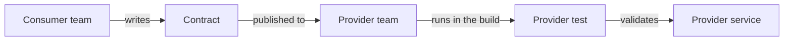

# Consumer-driven Contract Test

## Description

In Consumer-driven Contract Test, the developers of each consumer service write a set of tests (contracts) describing what they expect from a provider service's API. These contracts are handed to the provider's team, which runs them against its own service, in isolation, as part of the build pipeline.

The emphasis is on the **provider side**: the provider is validated against the contracts defined by the consumers. If a change to the provider breaks any recorded expectation, the test fails before deployment, with no need to bring both services up together. The complementary pattern, which validates the consumer against the same contract, is [Consumer-side Contract Test](/architecture/microservices/testing/consumer-side-contract-test).

## Problems it solves

- How to simply verify that a service offers the API its clients expect
- End-to-end tests that bring up several services are hard, slow, fragile, and expensive
- Changes to the provider can break consumers without the provider's team noticing

## When to use

- There are several services that call each other and the provider needs to know which parts of the API are actually used
- Different teams own the provider and the consumers and need an executable agreement
- You want to evolve the provider's API safely, without end-to-end tests

### When to avoid

- There's a single consumer under the same team, in which case a simple integration test is enough
- Consumers can't or won't keep their contracts up to date

## Trade-offs

| Benefit | Cost / Risk |
| --- | --- |
| Isolated provider testing that's faster, more reliable, and cheaper | Tests can pass and the application can still fail in production |
| Early feedback on compatibility breaks | Hard to ensure the written contracts reflect what the consumer actually needs |
| Contracts document real API usage | Requires a process to share and version contracts between teams |

- Works best combined with consumer-side tests, so that both sides use the same contract.
- Tools such as Spring Cloud Contract and Pact support this style.

## Diagram

The consumer defines the contract and the provider runs it against its own service, validating it in isolation.

## Related patterns

- [Consumer-side Contract Test](/architecture/microservices/testing/consumer-side-contract-test) — validates the consumer against the same contract
- [Service Component Test](/architecture/microservices/testing/service-component-test) — tests a service in isolation, with test doubles for the services it calls
- [Microservice Architecture](/architecture/microservices/architectural-style/microservice-architecture) — the context in which services depend on each other
- [Remote Procedure Invocation](/architecture/microservices/communication-styles/remote-procedure-invocation) — a communication style whose APIs are covered by the contracts
- [Messaging](/architecture/microservices/communication-styles/messaging) — contracts can also describe the messages exchanged

## Reference

- [Pattern page on microservices.io](https://microservices.io/patterns/testing/service-integration-contract-test.html)
