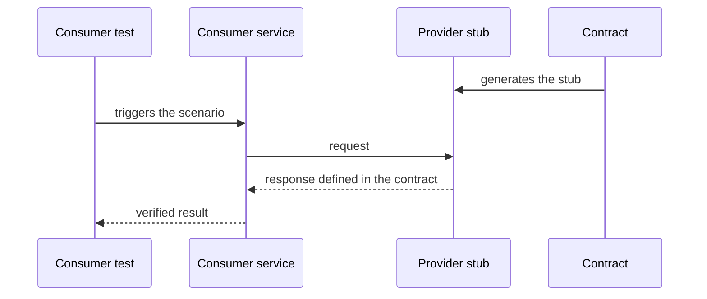

# Consumer-side Contract Test

## Description

Consumer-side Contract Test verifies that a service's client can communicate with it. The test runs on the **consumer side**: the provider service is replaced by a stub generated from the contract, and the consumer is exercised against that stub to confirm that it sends valid requests and correctly interprets the expected responses.

It's the mirror image of [Consumer-driven Contract Test](/architecture/microservices/testing/consumer-driven-contract-test). There, the provider is validated against the consumers' contracts. Here, the consumer is validated against the same contracts. Since both sides use the same contract, it works as a point of agreement between the teams, without bringing both services up together.

## Problems it solves

- How to know that the consumer really speaks the provider's language (request and response format)
- Stubs hand-written by the consumer can diverge from the provider's real behavior
- End-to-end tests to detect incompatibilities are slow, fragile, and expensive

## When to use

- A service depends on another's API and needs fast, deterministic tests
- There's a shared contract, also used to validate the provider
- You want to catch contract changes that break the client early

### When to avoid

- There's no contract maintained by the provider, making the stub just an assumption by the consumer
- The integration is trivial, or both belong to the same team and already have enough integration tests

## Trade-offs

| Benefit | Cost / Risk |
| --- | --- |
| Fast, isolated, reliable consumer tests | The stub can diverge from the real provider if the contract isn't verified against it |
| Fails early when the consumer violates the contract or the contract changes | Requires managing and versioning shared contracts |
| The same contract on both sides reduces misunderstandings | Passing the tests doesn't guarantee it works in production |

- The value is only complete when the provider also runs the contract (Consumer-driven Contract Test).
- Tools such as Pact and Spring Cloud Contract generate stubs from the contract.

## Diagram

The consumer is tested against a stub derived from the contract, without depending on the real provider.

## Related patterns

- [Consumer-driven Contract Test](/architecture/microservices/testing/consumer-driven-contract-test) — validates the provider against the consumers' contracts
- [Service Component Test](/architecture/microservices/testing/service-component-test) — tests a service in isolation using doubles for its dependencies
- [Remote Procedure Invocation](/architecture/microservices/communication-styles/remote-procedure-invocation) — a communication style covered by the contracts
- [Messaging](/architecture/microservices/communication-styles/messaging) — contracts can also describe messages

## Reference

- [Pattern page on microservices.io](https://microservices.io/patterns/testing/consumer-side-contract-test.html)
