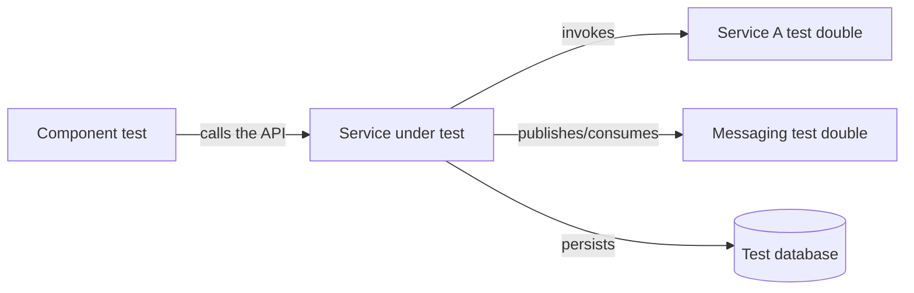

# Service Component Test

## Description

Service Component Test is a set of tests that exercises a single service in isolation, treating it as a black box accessed through its API. The services it invokes, and often infrastructure such as messaging, are replaced by test doubles (stubs or mocks), so the test doesn't depend on other services.

This validates the service's behavior end to end within its boundary, faster and more reliably than bringing up several services. The fidelity of the doubles can be ensured with contracts, as in the Contract Test patterns.

## Problems it solves

- How to test a service simply
- End-to-end tests that bring up several services are hard, slow, fragile, and expensive

## When to use

- You want to validate a service's behavior without depending on the others
- The build pipeline needs fast, deterministic feedback
- The service has remote dependencies that can be simulated

### When to avoid

- The doubles are maintained by hand and diverge from the dependencies' real behavior
- The service is so simple that unit tests already provide enough confidence

## Trade-offs

| Benefit | Cost / Risk |
| --- | --- |
| Tests that are easier, faster, more reliable, and cheaper | Tests can pass and the application can still fail in production |
| Isolation allows running without the other services | Ensuring the doubles reflect the real services is an open problem |
| Failures point straight at the service under test | More test code and doubles to maintain |

- Combining with Contract Tests reduces the risk of stale doubles.
- A small number of end-to-end tests is still recommended.

## Diagram

The service is exercised through its API and its remote dependencies are replaced by doubles.

## Related patterns

- [Consumer-driven Contract Test](/architecture/microservices/testing/consumer-driven-contract-test) — validates the provider against the consumers' contracts
- [Consumer-side Contract Test](/architecture/microservices/testing/consumer-side-contract-test) — contracts help keep the doubles faithful
- [Database per Service](/architecture/microservices/service-collaboration/database-per-service) — each service has its own database, making isolated testing easier
- [Microservice Architecture](/architecture/microservices/architectural-style/microservice-architecture) — the context of services that call each other

## Reference

- [Pattern page on microservices.io](https://microservices.io/patterns/testing/service-component-test.html)
