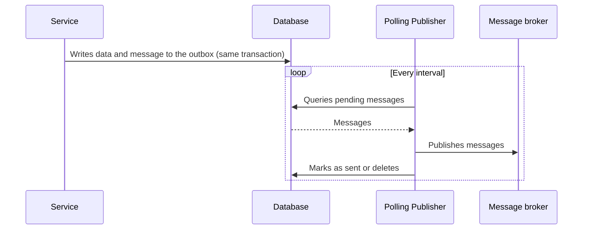

# Polling Publisher

## Description

Polling Publisher is one way to implement the message relay of the Transactional Outbox. A process repeatedly queries the outbox table in the database, reads the pending messages, and publishes them to the message broker, then marks them as sent or removes them.

It's the simplest approach to adopt, since it uses only ordinary database queries and doesn't depend on transaction-log-specific features.

## Problems it solves

- Moving messages and events from the outbox table to the broker after the Transactional Outbox has been applied.
- Getting a relay that works with any SQL database, without specific tooling.

## When to use

- The database is SQL and there's no easy access to the transaction log.
- Simplicity and portability matter more than minimum latency.
- The message volume is moderate.

### When to avoid

- Very low latency or high volume, since polling generates load and delay.
- The database is NoSQL without adequate support for this kind of query.
- Strict ordering is critical and can't be guaranteed with multiple concurrent publishers.

## Trade-offs

| Benefit | Cost / Risk |
| --- | --- |
| Works with any SQL database | Publishing events in order is tricky |
| Simple implementation with no specific dependencies | Not all NoSQL databases support the pattern |
| Easy to operate and debug | Extra query load and latency equal to the polling interval |

- Eventual consistency, with delay bounded by the polling interval.
- Multiple publisher instances require coordination (for example, row locking) to avoid duplicates and broken ordering.
- Consumers must be idempotent.

## Diagram

The publisher queries the outbox periodically, sends the messages to the broker, and updates the state in the database.

## Related patterns

- [Transactional Outbox](/architecture/microservices/transactional-messaging/transactional-outbox) — creates the need for this pattern
- [Transaction Log Tailing](/architecture/microservices/transactional-messaging/transaction-log-tailing) — an alternative that reads the database's transaction log
- [Idempotent Consumer](/architecture/cloud-design-patterns/messaging/idempotent-consumer) — needed to tolerate duplicate messages
- [Messaging](/architecture/microservices/communication-styles/messaging) — the communication style that uses the broker

## Reference

- [Pattern page on microservices.io](https://microservices.io/patterns/data/polling-publisher.html)
