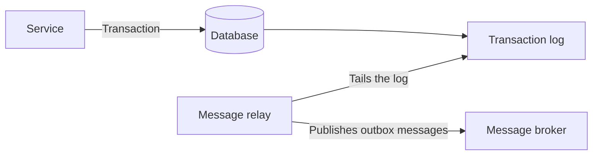

# Transaction Log Tailing

## Description

Transaction Log Tailing is one way to implement the message relay of the Transactional Outbox. Instead of querying the outbox table, the relay tails the database's transaction log and publishes to the message broker each message inserted into the outbox.

The mechanism depends on the database: MySQL's binlog, PostgreSQL's WAL, or DynamoDB's table streams, for example. Since the log records only committed transactions, in order, the relay sees exactly what was committed, with no need for two-phase commit.

## Problems it solves

- Getting messages from the outbox table to the broker after the Transactional Outbox has been applied.
- Avoiding the load and latency of periodic database queries.
- Publishing only what was actually committed, preserving the log's order.

## When to use

- The database exposes an accessible transaction log or change stream (binlog, WAL, streams).
- Low latency and strict publication ordering are important.
- The message volume makes polling costly for the database.

### When to avoid

- The database doesn't offer access to the log, or the team isn't familiar with this technology.
- A simple solution that's portable across databases is preferable.
- There's no operational capacity to maintain a database-specific connector.

## Trade-offs

| Benefit | Cost / Risk |
| --- | --- |
| No 2PC, with a faithful read of what was committed | Implementation specific to each database |
| Low latency and little read load on the database | A relatively obscure technique, although increasingly common |
| Order preserved by the log | Avoiding duplicate publication is hard |

- Eventual consistency: the message is published right after the commit, but asynchronously.
- Operations: you need to manage the log read position/offset and log retention.
- Consumers must still be idempotent.

## Diagram

The relay reads the database's transaction log, filters the inserts into the outbox, and publishes them to the broker.

## Related patterns

- [Transactional Outbox](/architecture/microservices/transactional-messaging/transactional-outbox) — creates the need for this pattern
- [Polling Publisher](/architecture/microservices/transactional-messaging/polling-publisher) — an alternative that queries the outbox periodically
- [Idempotent Consumer](/cloud/cloud-design-patterns/messaging/idempotent-consumer) — protects against duplicates on publication
- [Messaging](/architecture/microservices/communication-styles/messaging) — the communication style that uses the broker

## Reference

- [Pattern page on microservices.io](https://microservices.io/patterns/data/transaction-log-tailing.html)
