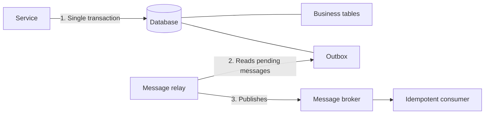

# Transactional Outbox

## Description

Transactional Outbox solves the problem of updating a service's database and, at the same time, sending a message or event to a message broker atomically. Instead of publishing directly to the broker, the service writes the message to an "outbox" table (or to a property of the record itself, in NoSQL databases) within the same local transaction that changes the business data.

A separate component, the message relay, reads the pending messages from the outbox and publishes them to the broker. Since writing the message and changing the data happen in the same transaction, the message exists if, and only if, the transaction was committed, and the order in which it was produced is preserved.

The relay's delivery is "at least once": it may publish the same message more than once (for example, if it fails after publishing and before marking the message as sent). That's why consumers need to be idempotent.

## Problems it solves

- Updating the database and publishing to the broker without two-phase commit (2PC), which is often unsupported or undesirable.
- Avoiding lost or "ghost" messages when publication happens inside or after the transaction and something fails in the middle.
- Sending the message only if the database transaction is committed.
- Preserving message order, even with several instances updating the same aggregate.

## When to use

- Sagas and domain events require that the state change and the publication be consistent.
- The database or the broker doesn't support distributed transactions.
- You need to guarantee that no event is lost or emitted without the corresponding data change.

## When to avoid

- The service uses Event Sourcing, where the event store already plays the role of a publishable event log.
- Occasional message loss is acceptable and the extra complexity isn't justified.
- Consumers can't be made idempotent and duplicates are unacceptable.

## Trade-offs

| Benefit | Cost / Risk |
| --- | --- |
| Atomicity between data and message without 2PC | Need for a message relay and an extra table/structure |
| Message order preserved | Possible duplicates, requiring idempotent consumers |
| No message lost or emitted without a commit | Easy to forget to write the event when changing the data |

- Eventual consistency: the message reaches the broker with some delay after the commit.
- Operational complexity: the relay must be monitored, and the outbox needs periodic cleanup.
- Coupling of the message schema to the service's database.

## Diagram

The service writes data and message in the same transaction; the relay reads the outbox and publishes to the broker, and the consumer handles possible duplicates.

## Related patterns

- [Transaction Log Tailing](/architecture/microservices/transactional-messaging/transaction-log-tailing) — a relay implementation that reads the database's transaction log
- [Polling Publisher](/architecture/microservices/transactional-messaging/polling-publisher) — a relay implementation that periodically queries the outbox
- [Saga](/architecture/cloud-design-patterns/distributed-coordination/saga) — creates the need to send messages atomically with the database update
- [Event Sourcing](/architecture/cloud-design-patterns/data-management/event-sourcing) — an alternative approach for publishing events reliably
- [Idempotent Consumer](/architecture/cloud-design-patterns/messaging/idempotent-consumer) — needed to tolerate duplicate messages from the relay
- [Messaging](/architecture/microservices/communication-styles/messaging) — the communication style that uses the broker

## Reference

- [Pattern page on microservices.io](https://microservices.io/patterns/data/transactional-outbox.html)
