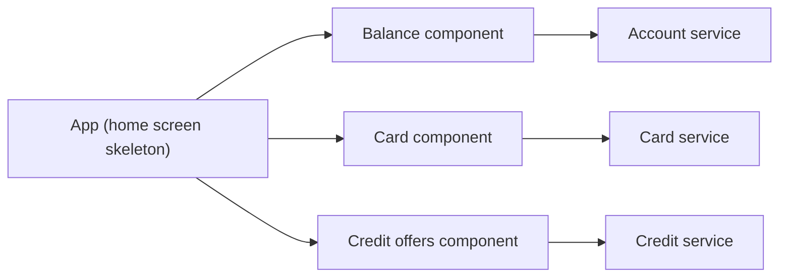

# Client-side UI Composition

## Description

In a microservices architecture with teams organized by business capability or subdomain, each team is also responsible for the user experience of its service. When a screen needs to display data from several services, such as a product page with details, purchase history, availability, and reviews, you have to decide where the composition happens.

In this pattern, each team develops a client-side UI component, such as an AngularJS directive or a web component, for the region of the screen belonging to its service. Each component fetches data from its own service. A UI team creates the page skeletons, which compose the service-specific components directly in the browser.

## Problems it solves

- How to implement a screen that displays data coming from several services
- Aligning the ownership of each part of the interface with the ownership of the service
- Letting regions of the page load and fail independently

## When to use

- Rich, interactive applications, such as SPAs
- When you want progressive loading of page regions
- When teams want to publish their components independently

## When to avoid

- When SEO or fast initial rendering on low-end devices is critical
- When many browser calls to several services would be a network problem
- When there's no design system convention to maintain visual consistency

## Trade-offs

| Benefit | Cost / Risk |
| --- | --- |
| Independent components per team | Risk of visual inconsistency and duplicated dependencies |
| Isolated failure per component | More client requests and exposure of the services |
| Rich, dynamic interface | Larger JavaScript load in the browser |

- It normally requires an API Gateway or BFF to expose the services to the client.
- A shared design system helps maintain consistency.
- Loading and error states need to be handled in each component.

## Diagram

The home screen skeleton in the app composes UI components, and each one queries its corresponding service. The source illustrates the pattern with product and inventory components.

## Related patterns

- [Server-side Page Fragment Composition](/architecture/microservices/ui-design/server-side-page-fragment-composition) — an alternative in which composition happens on the server
- [API Gateway](/architecture/microservices/external-api/api-gateway) — exposes the services to the client components
- [API Composition](/architecture/microservices/service-collaboration/api-composition) — data aggregation on the backend
- [Backends for Frontends](/architecture/cloud-design-patterns/gateways-and-edge/backends-for-frontends) — a backend dedicated to the client

## Reference

- [Pattern page on microservices.io](https://microservices.io/patterns/ui/client-side-ui-composition.html)
