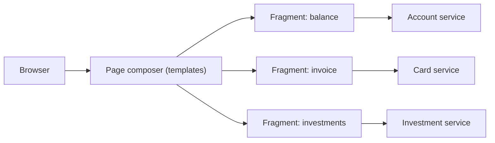

# Server-side Page Fragment Composition

## Description

In a microservices architecture with teams organized by business capability or subdomain, each team also owns the user experience related to its service. The problem arises when a single screen needs to display data from several services, such as a product page that shows details, availability, reviews, and related items.

In this pattern, each team develops a web application that generates the HTML fragment for the page region it's responsible for. A UI team maintains the page templates, which assemble the final page on the server by aggregating the fragments from each service, for example through a server-side include mechanism. The browser receives the page already composed.

## Problems it solves

- How to implement a screen that displays data coming from several services
- Keeping ownership of each UI region with the team that owns the respective service
- Preventing a single team or front-end application from centralizing all the presentation logic

## When to use

- Server-rendered pages, with HTML as the main format
- When SEO and time to first render are important
- When service teams want to deliver their fragments independently

## When to avoid

- Highly interactive interfaces that depend on rich client-side components
- When the latency of assembling many fragments in series on the server is unacceptable
- When there's no team or convention to keep the page templates and styling consistent

## Trade-offs

| Benefit | Cost / Risk |
| --- | --- |
| Each team controls its service's fragment | Need to coordinate layout, styles, and fragment contracts |
| The page arrives ready at the browser | Page latency depends on the slowest fragment |
| Independent deployment of fragments | Failure of one fragment can degrade the whole page |

- It's advisable to define timeouts and fallback content for each fragment.
- Observability should correlate the page request with the calls to each fragment.
- A fragment cache reduces load and latency.

## Diagram

The page composer assembles on the server the HTML fragments generated by each service and returns the complete internet banking home page to the browser. The source illustrates the pattern with a book page.

## Related patterns

- [Client-side UI Composition](/architecture/microservices/ui-design/client-side-ui-composition) — an alternative in which composition happens on the client
- [API Composition](/architecture/microservices/service-collaboration/api-composition) — aggregates data from several services, but at the API level rather than the UI level
- [API Gateway](/architecture/microservices/external-api/api-gateway) — an entry point that can route the page request
- [Backends for Frontends](/architecture/cloud-design-patterns/gateways-and-edge/backends-for-frontends) — a backend dedicated to each client type

## Reference

- [Pattern page on microservices.io](https://microservices.io/patterns/ui/server-side-page-fragment-composition.html)
