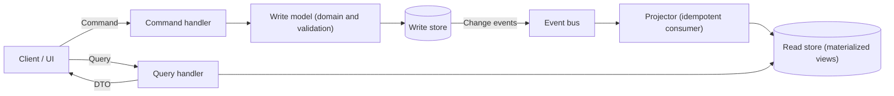

# CQRS

## Description

CQRS (Command Query Responsibility Segregation) separates the operations that change data (*commands*) from the operations that read data (*queries*), using distinct models for each side. This way, each model can be optimized independently for performance, scalability, and security.

*Commands* represent business tasks with clear intent (for example, "Book room" instead of "Set status to Booked"). They go through validation and domain rules in the write model, which guarantees transactional consistency. *Queries* never change state: they return data transfer objects (DTOs) or projections already in the shape the presentation layer needs, with no domain logic.

The separation can exist at two levels. In the simplest, both models share the same store but have distinct logic. In the most advanced, each side has its own store, even with different technologies (relational for writes and a document database for reads, for example). In that case, the write model publishes events on every change, and the read model consumes them to update its views. For this to be reliable, use a mechanism like the *transactional outbox* and idempotent consumers.

In microservices with Database per Service, CQRS takes on an additional role: it's the way to answer queries that need data from several services. You build a view database (read-only), with a type and schema chosen for the query (often a NoSQL store, such as a document or key-value store), kept up to date by subscribing to the domain events published by the services that own the data. With Event Sourcing, CQRS is practically mandatory, since the event log is hard to query directly.

## Problems it solves

- Difference between how data is represented for writes and for reads: fields that are required on update are irrelevant to the query, and vice versa.
- Lock contention when many parallel read and write operations hit the same set of data.
- Poor performance from complex queries (many joins and mappings) and from load concentrated on a single store and data access layer.
- Difficulty applying security when the same entity serves reads and writes, which can expose data in the wrong contexts.
- Queries that need data from several services when each keeps its own private database and a direct *join* isn't possible.
- A single model that gets too complex to serve both kinds of operation well.

## When to use

- Collaborative environments, where many users change the same data at the same time and granular *commands* help reduce and resolve conflicts.
- Task-oriented interfaces and complex domains, with aggregates and rich business rules on the write side.
- Workloads with far more reads than writes, where the read side needs to scale horizontally and the write side runs on fewer instances.
- Separate teams: one handles the write-side business logic and the other handles the read views and the interface.
- Systems that evolve frequently, with new model versions and changes to business rules.
- Integration with other subsystems, especially those that use Event Sourcing, so that the failure of one component doesn't bring down the whole system.

### When to avoid

- Simple domain or business rules.
- Applications where a CRUD-style interface and data access are enough.
- Scenarios that require immediately consistent reads after every write and can't tolerate stale data.

## Trade-offs

| Benefit | Cost / Risk |
| --- | --- |
| Independent scaling of reads and writes | More components to deploy, monitor, and operate |
| Schemas optimized for querying and for updating | Synchronizing the models requires custom code, and scaffolding/ORM tools don't generate it automatically |
| Simple queries over materialized views, without complex joins | Eventual consistency: a read may show stale data |
| Less lock contention and better performance under load | Messaging brings failures, duplicates, and reprocessing that must be handled |
| Finer-grained access control over who can write | Higher design complexity, especially with Event Sourcing |
| Cleaner, more cohesive models (separation of concerns) | Generating or rebuilding projections can take a lot of time and resources |

- **Consistency:** define how the application detects and handles user actions based on stale data (for example, optimistic versioning in the *command*).
- **Atomicity:** since the database and the message broker normally don't take part in the same distributed transaction, write the change and the event atomically (*transactional outbox*) and make the read-side consumers idempotent.
- **Code duplication:** in microservices, logic shared between the views and the source services may be duplicated.
- **Simpler alternative:** for small queries, API Composition avoids the event and view infrastructure, at the cost of in-memory *joins*.
- **Propagation latency:** measure and monitor the delay between the write and the projection update.
- **Event Sourcing:** if combined, the *event store* becomes the source of truth and projections can be rebuilt by replaying the events. Use periodic snapshots to avoid reprocessing the entire history.
- **Asynchronous processing:** *commands* can go to a queue (for example, Azure Service Bus) and have different priorities.

## Diagram

The client sends *commands* to the write model, which validates them, applies the domain rules, and persists the data. The changes become events that asynchronously update the views in the read store, from which *queries* return DTOs ready for display.

## Related patterns

- [Event Sourcing](/cloud/cloud-design-patterns/data-management/event-sourcing): often combined with CQRS. The *event store* serves as the write model, and the read projections are generated from the events.
- [Materialized View](/cloud/cloud-design-patterns/data-management/materialized-view): the read model usually holds materialized, denormalized views optimized for querying.
- [Idempotent Consumer](/cloud/cloud-design-patterns/messaging/idempotent-consumer): the consumers that update the read model must tolerate duplicate events.
- [Publisher-Subscriber](/cloud/cloud-design-patterns/messaging/publisher-subscriber): the usual way to propagate events from the write side to one or more read projections.
- [Priority Queue](/cloud/cloud-design-patterns/messaging/priority-queue): helps process *commands* with different priorities.
- [Queue-Based Load Leveling](/cloud/cloud-design-patterns/messaging/queue-based-load-leveling): queueing *commands* smooths out write spikes.
- [Cache-Aside](/cloud/cloud-design-patterns/data-management/cache-aside): another way to speed up reads, and it can complement the read model.
- [Database per Service](/architecture/microservices/service-collaboration/database-per-service): creates the need for views that combine data from several services.
- [API Composition](/architecture/microservices/service-collaboration/api-composition): a simpler alternative for queries across services.
- [Domain Event](/architecture/microservices/service-collaboration/domain-event): events that keep the views up to date.
- [Command-side Replica](/architecture/microservices/service-collaboration/command-side-replica): structurally identical, but the replica serves the command side.

## Reference

- [Documentation in the Azure Architecture Center](https://learn.microsoft.com/en-us/azure/architecture/patterns/cqrs)
- [CQRS on microservices.io](https://microservices.io/patterns/data/cqrs.html)
