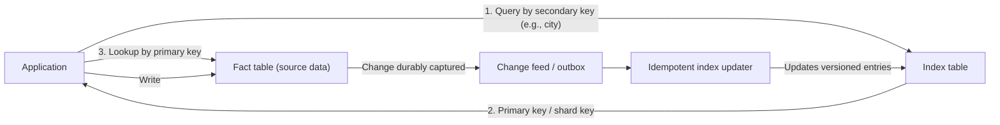

# Index Table

## Description

Many data stores organize entities only by the primary key (or by the partition/shard key). When the application needs to query by another attribute, such as a customer's city or last name, and the store doesn't offer suitable secondary indexes, the alternative would be to scan all records. The Index Table pattern solves this by creating and maintaining separate index tables, organized by the secondary keys that queries use frequently.

There are three main structuring strategies: **full denormalization** (each index table duplicates the entire record, organized by a different key), **normalized index** (the index holds only a reference to the primary key in the source table, the "fact table", requiring two reads), and **partial denormalization** (the index duplicates only the most queried fields and references the source for the rest). You can also use **composite keys** (for example, city + last name), with an encoding that preserves the boundaries between components and the desired ordering.

In partitioned data with a hash-based shard key, the index table can organize entries by non-hash values and store each record's shard key. This enables range and ordered queries, and also routes each read directly to the right shard. When the source and the indexes can't be updated in the same transaction, index maintenance is usually asynchronous and eventually consistent.

## Problems it solves

- Queries by attributes that aren't the primary key require full scans, which are slow and expensive.
- The data store doesn't offer secondary indexes, or the native indexes don't meet the query, partitioning, or performance requirements.
- In hash-sharded data, range or ordered queries aren't possible without querying all shards.
- Frequent queries by combinations of attributes (for example, "customers in a city with a given last name") have no efficient access path.

## When to use

- The application frequently retrieves data by a key other than the primary key or the shard key.
- The store doesn't natively support secondary indexes, or the existing indexes don't fit the workload.
- The workload is predominantly reads and the indexed data changes infrequently.
- A brief lag (eventual consistency) between the source and the index is acceptable.

### When to avoid

- The data is highly volatile: the write rate exceeds the capacity to update the indexes, which stay permanently stale.
- The secondary key has low selectivity (for example, a boolean field), offering little selectivity for the total storage and throughput cost.
- The distribution of values is heavily skewed (for example, 90% of records with the same value), unless the queries specifically target the rare values.
- Queries on that attribute are rare or speculative; the cost of maintaining the index doesn't pay off.

## Trade-offs

| Benefit | Cost / Risk |
| --- | --- |
| Fast lookups by non-key fields, without a full scan | Maintenance overhead for each additional index table |
| Range and ordered queries over hash-sharded data | Higher storage consumption and write throughput |
| Denormalization lets common queries be answered with a single read | Normalized indexes require two reads (index, then source) |
| Asynchronous maintenance keeps index failures from blocking writes to the source | Eventual consistency: the index may return stale references or omit recent records |

- **Consistency:** durably capture every change to the source before confirming the write (change feed, transactional outbox, or queued command); don't update the source and publish the index message independently.
- **Idempotency and ordering:** the consumer that updates the indexes must be idempotent and use a version or sequence number to discard old updates; keep versioned tombstones for deletions.
- **Index partitioning:** the index tables themselves may need to be partitioned, aligned with the query patterns they serve.
- **Observability and governance:** monitor lag and dead-letter messages, and run periodic reconciliations; review and remove indexes that are no longer queried.

## Diagram

The application queries the index table by the secondary key, gets the primary (or shard) key, and fetches the full record from the fact table. Writes to the source are durably captured and propagated asynchronously by an idempotent updater that maintains the indexes.

## Related patterns

- [Sharding](/cloud/cloud-design-patterns/data-management/sharding) — index tables make it possible to locate records and run range queries over sharded data.
- [Materialized View](/cloud/cloud-design-patterns/data-management/materialized-view) — another way to pre-organize derived data to serve specific queries.
- [Idempotent Consumer](/cloud/cloud-design-patterns/messaging/idempotent-consumer) — the asynchronous index updater must tolerate duplicate messages.
- [CQRS](/cloud/cloud-design-patterns/data-management/cqrs) — separates read and write models, often with denormalized indexes on the read side.
- [Event Sourcing](/cloud/cloud-design-patterns/data-management/event-sourcing) — events can feed the construction and reconstruction of the index tables.

## Reference

- [Documentation in the Azure Architecture Center](https://learn.microsoft.com/en-us/azure/architecture/patterns/index-table)
