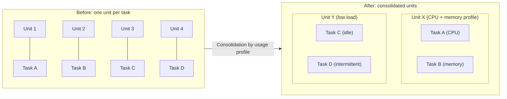

# Compute Resource Consolidation

## Description

The Compute Resource Consolidation pattern groups multiple tasks or operations into a single computational unit (a virtual machine, a container, a hosting plan, or a node pool) instead of keeping each one in a dedicated unit. The goal is to increase the utilization of provisioned resources and reduce the cost and management effort associated with many isolated units.

In cloud applications it's common to start by separating each function into its own execution unit, which simplifies the logical design. However, each unit consumes billable resources even when it's idle or barely used. With consolidation, tasks with compatible requirements share the same capacity, which stays busy for longer.

The choice of what to group is the central point: tasks with similar scalability, lifecycle, and release cadence, and with complementary consumption profiles (for example, one CPU-intensive and one memory-intensive), are good candidates. Tasks with conflicting scaling requirements, tasks that compete for the same resource, or tasks that require security isolation should stay separate.

## Problems it solves

- High hosting cost caused by many underused or idle compute units.
- Overprovisioned capacity and expensive resources that sit idle for long periods.
- Operational overhead of managing, monitoring, updating, and automating many heterogeneous units.
- A fragmented execution platform, with different tools and operational processes for each component.
- Communication latency between tasks that could talk locally within the same unit.

## When to use

- Tasks that aren't cost-effective when run in their own units.
- Tasks that are frequently idle or have low, intermittent load.
- Tasks that would be expensive in a dedicated unit but can take advantage of the idle capacity of a shared unit.
- Tasks with similar scalability, lifecycle, and release cadence requirements, which can scale as a block.
- Systems already in production, with monitoring data (a resource-usage "heat map") that makes it possible to identify good consolidation candidates.

### When to avoid

- Tasks that perform critical operations requiring fault tolerance and can't be affected by neighbors.
- Tasks that process highly sensitive or private data and need their own security context.
- Tasks that need an isolated environment in a separate compute unit (due to regulatory, licensing, or performance requirements).
- Tasks with conflicting scaling requirements (for example, one that receives traffic spikes and another that consumes a low-volume queue).
- Tasks that compete for the same resource (two CPU-intensive or two memory-intensive tasks).
- Tasks with very different release cycles, where deploying one forces a restart of all the others.

## Trade-offs

| Benefit | Cost / Risk |
| --- | --- |
| Lower cost through better utilization of provisioned capacity | Resource contention between tasks sharing the unit (the "noisy neighbor" effect) |
| More homogeneous platform, with simplified management and observability | A failure or anomalous behavior in one task can affect the others (larger blast radius) |
| Fewer distinct tools and operational processes | Shared security context and a larger attack surface; each task is only as secure as the most vulnerable one |
| Faster communication between colocated tasks | Coupled scaling: all tasks scale together, even if only one needs it |
| Use of larger instances (vertical scaling) and of idle capacity | Deploying one task may require stopping and redeploying the whole unit |

- **Scalability and elasticity:** don't group tasks with conflicting scaling needs; the autoscaling policy applies to the whole unit.
- **Lifecycle:** the infrastructure may periodically recycle the unit; long-running tasks need checkpointing or mechanisms to postpone recycling.
- **Contention:** combine tasks with complementary consumption profiles and define per-task resource limits (CPU, memory) when the platform allows it.
- **Complexity:** several tasks in the same unit make testing, debugging, and maintenance harder; keep the logical architecture stable so that each task's code doesn't depend on where it's hosted.
- **Observability:** monitor consumption per task, not just per unit, to detect contention and reassess the grouping over time.
- **Alternatives:** consolidation is just one cost-reduction strategy; serverless models that scale to zero or container orchestration platforms can offer the same benefit with better isolation.

## Diagram

Before, each task occupies its own compute unit, often idle. After consolidation, tasks with complementary profiles or low load share units, reducing the number of provisioned resources and increasing their utilization.

## Related patterns

- [Sidecar](/cloud/cloud-design-patterns/integration-and-modernization/sidecar) — also colocates components in the same execution unit, sharing resources and lifecycle with the main application.
- [Bulkhead](/cloud/cloud-design-patterns/resiliency/bulkhead) — the opposite approach: isolates resources to contain failures; helps decide which tasks should not be consolidated.
- [Deployment Stamp](/cloud/cloud-design-patterns/deployment-and-topology/deployment-stamp) — groups components and even tenants into shared deployment units, with similar cost versus isolation trade-offs.
- [Competing Consumers](/cloud/cloud-design-patterns/messaging/competing-consumers) — multiple queue consumers can run in consolidated units and scale together when they have a similar profile.
- [Queue-Based Load Leveling](/cloud/cloud-design-patterns/messaging/queue-based-load-leveling) — smooths out load spikes, making resource consumption more predictable and consolidation easier.
- [Health Endpoint Monitoring](/cloud/cloud-design-patterns/resiliency/health-endpoint-monitoring) — monitoring the health of each task is essential when several share the same unit.

## Reference

- [Azure Architecture Center documentation](https://learn.microsoft.com/en-us/azure/architecture/patterns/compute-resource-consolidation)
