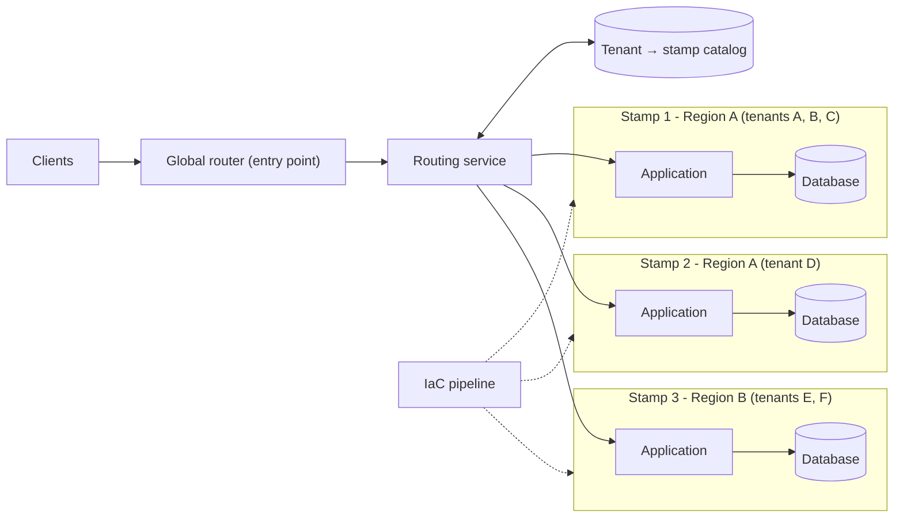

# Deployment Stamps

## Description

The Deployment Stamps pattern consists of deploying multiple independent copies of an application's components, including the data stores, as a single group of resources. Each copy is called a *stamp* (also known as a *service unit*, *scale unit*, or *cell*). In a multitenant environment, each stamp serves a predefined set of tenants, and the solution scales almost linearly as new stamps are added.

Stamps work in isolation: each one can be deployed, updated, and monitored separately, and a single region can contain one or several stamps. Because each stamp holds only its tenants' data, the pattern implicitly partitions the data. When there's a single entry point, a routing service looks up a "tenant → stamp" mapping and forwards (or redirects) each request to the correct stamp.

Because the pattern relies on identical copies of the infrastructure, infrastructure as code and automated deployment pipelines are essential to keep stamps predictable, repeatable, and free of configuration drift. It differs from the Geode pattern: in Deployment Stamps each instance serves only a subset of customers, while in Geode any instance serves any user.

## Problems it solves

- Scale limits of a single instance (connections, hostnames, sockets, service quotas)
- Components whose cost or performance doesn't scale linearly beyond a certain point
- The need to isolate data or load of certain customers ("noisy" tenants or those with security requirements)
- Coexistence of single-tenant (dedicated instance) and multitenant (shared instance) customers
- Controlled, gradual rollout of updates to subsets of customers (deployment rings)
- Customers with different tolerances for update frequency
- Latency or data sovereignty requirements that call for hosting customers in specific regions

## When to use

- The solution has natural scalability limits and some components can't or shouldn't serve more than a certain number of customers or requests
- Some tenants need to be separated from the rest, for example due to security or compliance requirements
- Tenants need to be kept on different versions of the solution at the same time
- The application is multi-region and each tenant's traffic and data must stay in a specific region
- You want to limit the blast radius of failures and incidents to a subset of customers
- The product is a SaaS that needs to grow by adding standardized scale units

### When to avoid

- The solution is simple and doesn't need to scale much
- It's possible to scale vertically or horizontally within a single instance
- Data needs to be replicated across all instances (consider the Geode pattern)
- Only some components need to scale; partitioning the data store (Sharding) may be enough
- The solution has only static content; Static Content Hosting with a CDN is more appropriate

## Trade-offs

| Benefit | Cost / Risk |
| --- | --- |
| Near-linear scaling by adding new stamps | Higher cost from duplicating the entire infrastructure in each stamp |
| Fault isolation: a stamp with problems doesn't affect the others | Stamps aren't redundant with each other by default; an outage in a region affects the tenants hosted there |
| Gradual per-stamp rollouts (rings, canary) reduce the risk of changes | Requires mature automation (infrastructure as code, pipelines) to avoid configuration drift |
| Per-customer data isolation and regional residency | Moving tenants between stamps requires specific migration logic |
| Flexibility to combine dedicated and shared stamps | Need for a highly available routing service and a "tenant → stamp" catalog |

- **Cross-stamp operations:** global reports (for example, total customers) require querying and aggregating each stamp or centralizing the data in a data warehouse.
- **Capacity:** define a stamp's capacity with a surrogate metric (number of tenants, load) obtained through load testing, monitor usage, and provision new stamps proactively.
- **Minimum number:** deploy at least two stamps from the start to avoid hard-coded assumptions in code or configuration.
- **Observability:** centralize metrics, logs, traces, and alerts from all stamps to quickly identify unhealthy stamps.
- **Governance:** treat security policies, access control, and configuration as code and continuously validate drift between stamps.
- **Shared components:** some elements (such as a static front end) can be shared across stamps and distributed via a CDN.

## Diagram

Requests arrive through a global entry point, and the routing service consults the catalog to find out which stamp the tenant lives in. Each stamp is a complete, independent copy of the application and data, provisioned identically by an infrastructure-as-code pipeline.

## Related patterns

- [Geodes](/cloud/cloud-design-patterns/deployment-and-topology/geodes) — an alternative where any instance serves any user; it can also be used for the routing service itself
- [Sharding](/cloud/cloud-design-patterns/data-management/sharding) — stamps implicitly partition the data; sharding may be enough when only storage needs to scale, or it can be used inside each stamp
- [Gateway Routing](/cloud/cloud-design-patterns/gateways-and-edge/gateway-routing) — the routing service acts as a gateway that directs requests to the correct stamp
- [Gateway Offloading](/cloud/cloud-design-patterns/gateways-and-edge/gateway-offloading) — the routing gateway can centralize token validation, throttling, and authorization
- [Static Content Hosting](/cloud/cloud-design-patterns/deployment-and-topology/static-content-hosting) — an alternative when the solution is only static content, or for components shared across stamps
- [Bulkhead](/cloud/cloud-design-patterns/resiliency/bulkhead) — each stamp works as an isolated partition that contains the impact of failures

## Reference

- [Azure Architecture Center documentation](https://learn.microsoft.com/en-us/azure/architecture/patterns/deployment-stamp)
