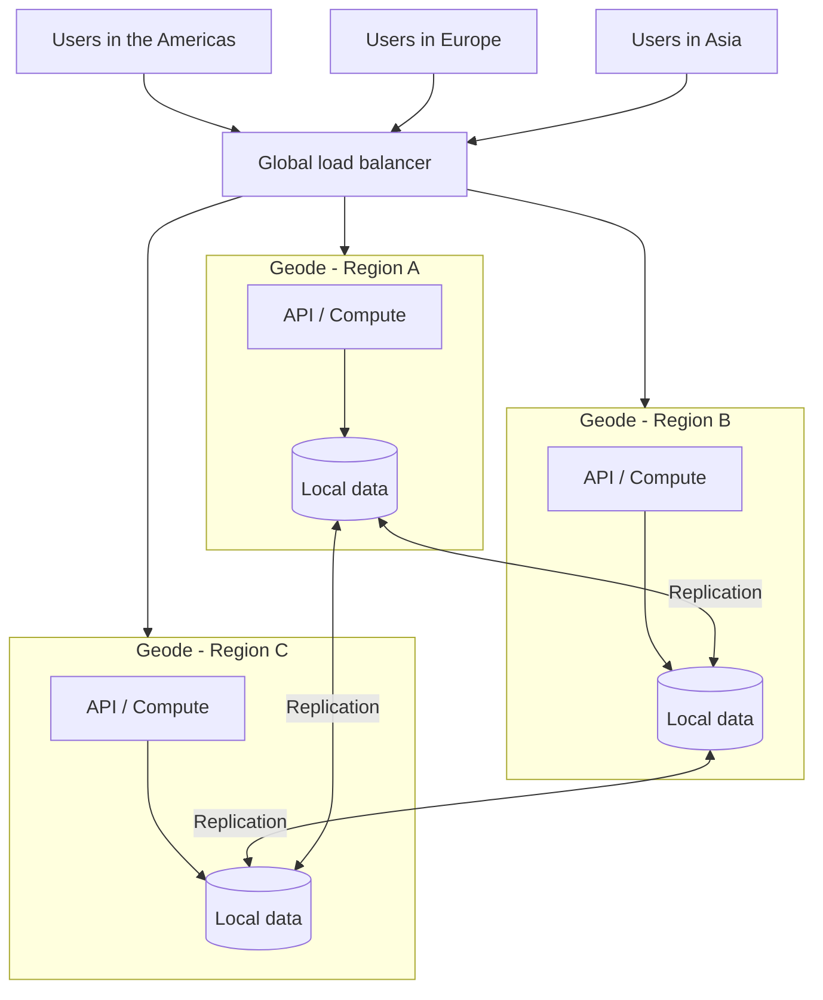

# Geode

## Description

The Geode pattern (from **ge**ographical n**ode**) consists of deploying the same set of backend services across multiple geographic nodes around the world, where each node can serve any request from any client, in any region. It's an *active-active* approach: instead of bringing the data to a central processing point, the pattern *brings the processing to the data*, placing compute and storage side by side in each region.

Each geode is self-contained: it bundles all the resources it needs (compute, API, storage, secrets), typically defined by an infrastructure template, and doesn't depend on any other geode to operate. Geodes sit behind a global load balancer, which routes the client to the nearest or healthiest node, and share a data replication *backplane* (a distributed database with multi-region writes, such as Azure Cosmos DB) that keeps data consistent across all of them.

Unlike a deployment stamp, a geode never exists in isolation: a production environment always has more than one. The solution's resilience grows with each geode added, since any node can take over traffic when one or more regions become unavailable.

## Problems it solves

- High latency for users geographically far from the service's single hosting location
- Demand spikes that overload the services of a single region
- Total service outage when an entire region fails
- Reliance on *scale-up* of a central database as the only way to grow
- The complexity and cost of maintaining infrastructure copies in several regions without a standardized, replicable model

## When to use

- Large-scale platforms with users spread across a wide geographic area
- Services that require extreme availability and resilience, able to survive the simultaneous loss of several regions
- Cloud-native applications that can treat all nodes as equivalent for reading and writing data
- Near-edge computing scenarios, where reducing response time is a priority

### When to avoid

- When not all geodes can be identical with regard to data, for example due to data residency requirements, temporary session state tied to a region, or traffic heavily concentrated in a single region (in that case, prefer deployment stamps with global routing that is aware of data location)
- When there's no real need for geographic distribution; availability zones and paired regions may be enough
- When adapting legacy platforms, since the pattern is designed for cloud-native development and is hard to retrofit
- In simple architectures, where redundancy and geographic distribution bring no advantage

## Trade-offs

| Benefit | Cost / Risk |
| --- | --- |
| Lower latency, with the client served by the nearest node | Infrastructure and replication cost multiplied by the number of geodes |
| High availability: the service survives the loss of one or more regions | Data consistency across regions depends on the replication backplane and its consistency model |
| Horizontal scalability: each geode scales independently | Highly distributed, decoupled architecture, harder to debug and trace |
| Absorbs regional spikes by redistributing load across geodes | More secrets and entry points, increasing the attack surface |
| Standardized, repeatable deployment via templates | Requires mature DevOps automation to keep all geodes identical |

Additional considerations:

- **Consistency:** decide whether each region processes its data locally or whether aggregations are done in a single geode and the result is replicated globally; each option has advantages and disadvantages.
- **Cost:** prefer serverless or pay-per-use technologies to reduce the cost of keeping many geodes always on; run load tests comparing "more geodes" with "more powerful nodes".
- **Observability:** parts of the same request may run asynchronously in different geodes; use distributed tracing and centralized monitoring.
- **Security:** ensure the global front end is the only entry point, restrict storage access to the geode's own compute layer, and centralize secrets management.
- **Data availability:** features such as multi-region writes and availability zones in the database increase resilience, but also cost.

## Diagram

The global load balancer routes each user to the nearest or available geode; each geode is self-contained and processes the request with its own data, while the replication backplane keeps the data identical across all regions, allowing any geode to serve any request.

## Related patterns

- [Deployment Stamp](/cloud/cloud-design-patterns/deployment-and-topology/deployment-stamp) — also replicates deployment units, but each stamp may serve an isolated subset of customers; it's the alternative when geodes can't be equivalent with regard to data
- [Gateway Routing](/cloud/cloud-design-patterns/gateways-and-edge/gateway-routing) — the global routing in front of the geodes applies the same idea of forwarding requests to the appropriate backend
- [Sharding](/cloud/cloud-design-patterns/data-management/sharding) — an alternative for distributing data by region when it isn't possible to replicate everything to all nodes
- [Health Endpoint Monitoring](/cloud/cloud-design-patterns/resiliency/health-endpoint-monitoring) — the global load balancer depends on health checks to take unavailable geodes out of rotation
- [Static Content Hosting](/cloud/cloud-design-patterns/deployment-and-topology/static-content-hosting) — complements the pattern by serving static content from the edge, close to users
- [Rate Limiting](/cloud/cloud-design-patterns/resiliency/rate-limiting-pattern) — can be applied at each geode's API layer to protect the backplane's shared resources

## Reference

- [Azure Architecture Center documentation](https://learn.microsoft.com/en-us/azure/architecture/patterns/geodes)
