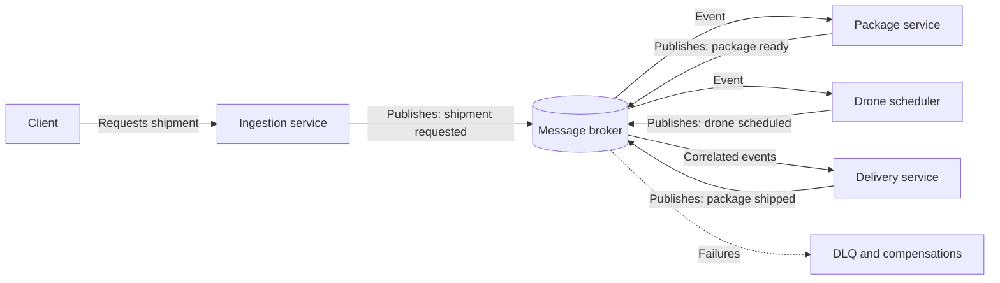

# Choreography

## Description

The Choreography pattern distributes the logic of a business flow among the services that take part in it, instead of concentrating it in a central orchestrator. Each service decides, based on its own business rules, when and how to process an operation, and reacts to events published by other services without knowing the full flow or calling the others directly.

The most common implementation uses a message broker in a publish/subscribe model. A client request becomes a message; the interested services consume it, perform their part, and publish a new success or failure event. Other services react to those events to continue the flow or, on failure, to run compensating actions.

As a result, components are loosely coupled and can be added, replaced, or removed with little impact on the rest of the system. The flip side is that nobody holds the complete state of an in-flight transaction. Observability, idempotency, and failure handling therefore become the responsibility of each participant.

## Problems it solves

- A central orchestrator that becomes a performance bottleneck under load or a single point of failure (SPoF), propagating failures to all dependent services
- Complex orchestration logic that is hard to maintain and must be rewritten whenever a service is added or removed
- Tight coupling between services caused by many point-to-point calls within a single business transaction
- Difficulty scaling distributed flows independently per service

## When to use

- Components perform atomic, independent operations in a *fire and forget* style, signaling completion through events
- Components are updated or replaced frequently and changes must cause minimal impact
- Serverless or event-driven architectures with simple flows and short-lived components
- Communication between different bounded contexts, which requires low coupling across domain boundaries
- The central orchestrator has become a performance bottleneck

### When to avoid

- The application is complex and needs a central component with shared logic to keep the services simple
- Point-to-point communication between components is unavoidable
- You need to consolidate the results of all service operations using business rules (in that case, an orchestrator is a better fit)
- The flow is long and strictly sequential, with many dependencies between steps
- Within a single bounded context, where an orchestrator is usually simpler to understand and operate

## Trade-offs

| Benefit | Cost / Risk |
| --- | --- |
| Removes the orchestrator as a bottleneck and single point of failure | No component has the full view of the state of an in-flight transaction |
| Autonomous, replaceable services that evolve with little impact on the system | Event schema evolution can break consumers; requires versioned, compatible contracts |
| Independent scalability per service and natural parallel processing | Sequential flows (waiting for several events before proceeding) require correlation and get complex |
| Low coupling between domains | Distributed failure handling and more complex compensations, which are also subject to failure |
| Easy to add new consumers of an event without changing the producer | Risk of emergent behavior, event loops, and "event storms" |

- **Observability:** use distributed tracing and correlation IDs in every message to reconstruct the flow end to end.
- **Idempotency and ordering:** "at-least-once" delivery produces duplicates and out-of-order messages; consumers must be idempotent and, when order matters, use sessions, sequence numbers, or versions.
- **Atomicity between state and event:** writing to the database and publishing the event as separate operations can leave the system inconsistent; use Transactional Outbox or an equivalent mechanism.
- **Resilience:** without an orchestrator, retries and timeouts are left to each service or to a dedicated resilience component, which increases point-to-point communication. Invalid messages should go to a dead-letter queue (DLQ) to avoid cascading retries.
- **Cascade protections:** event filtering, concurrency limits, throttling, and explicit rules to avoid circular chains.

## Diagram

No service coordinates the others: each one reacts to events from the broker and publishes the result of its own part. The delivery service only proceeds after receiving both events (package ready and drone scheduled), correlated by the delivery identifier.

## Related patterns

- [Publisher-Subscriber](/cloud/cloud-design-patterns/messaging/publisher-subscriber) — the messaging mechanism most commonly used to implement choreography between services
- [Saga](/cloud/cloud-design-patterns/distributed-coordination/saga) — manages consistency of distributed transactions and can be implemented through choreography or orchestration
- [Compensating Transaction](/cloud/cloud-design-patterns/distributed-coordination/compensating-transaction) — undoes work already completed when a step in the choreographed flow fails
- [Idempotent Consumer](/cloud/cloud-design-patterns/messaging/idempotent-consumer) — ensures that duplicate or reprocessed messages don't cause repeated side effects
- [Retry](/cloud/cloud-design-patterns/resiliency/retry) — handles transient failures in message processing within each service
- [Event Sourcing](/cloud/cloud-design-patterns/data-management/event-sourcing) — records state changes as events, which can feed the choreographed flow
- [Competing Consumers](/cloud/cloud-design-patterns/messaging/competing-consumers) — lets you scale each participating service with multiple instances consuming from the same queue
- [Throttling](/cloud/cloud-design-patterns/resiliency/throttling) — helps contain event cascades and consumer overload
- [Ambassador](/cloud/cloud-design-patterns/integration-and-modernization/ambassador) and [Sidecar](/cloud/cloud-design-patterns/integration-and-modernization/sidecar) — can encapsulate connectivity and resilience concerns alongside each service

## Reference

- [Azure Architecture Center documentation](https://learn.microsoft.com/en-us/azure/architecture/patterns/choreography)
