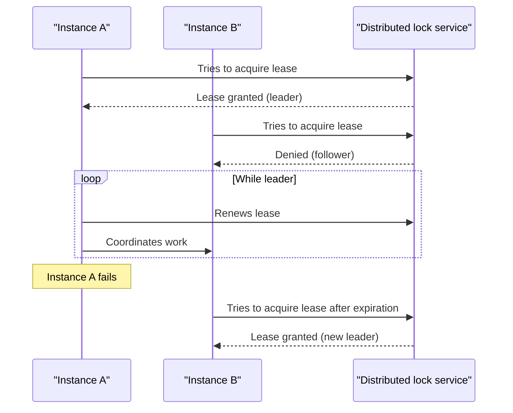

# Leader Election

## Description

The Leader Election pattern coordinates the actions of a set of collaborating instances of a distributed application by electing one of them as leader. The leader takes responsibility for coordinating the others (followers), preventing them from conflicting, competing for shared resources, or interfering with each other's work.

Because all instances normally run the same code, any of them can be the leader. The election must therefore be done carefully to prevent two instances from taking leadership at the same time. Common strategies include competing for a shared distributed mutex (for example, a lease with an expiration time, periodically renewed by the leader) or using classic election and consensus algorithms such as Bully, Raft, or Chang and Roberts.

The follower instances monitor the leader through heartbeat, polling, or lease expiration. If the leader fails, becomes unreachable, or can't renew the lease, a new election takes place and another instance takes over coordination.

## Problems it solves

- Multiple identical, horizontally scaled instances writing to a shared resource and overwriting each other's changes
- The need to aggregate the results of tasks running in parallel when there is no natural coordinator
- Tasks that must be run by a single instance at a time (scheduled jobs, rebalancing, cleanup), even with several active replicas
- Loss of coordination when the coordinating process fails, with no automatic replacement mechanism

## When to use

- The tasks of a distributed application need careful coordination and there is no natural leader among peer instances
- You need to guarantee that only one instance performs a given responsibility, with automatic failover on failure
- The system scales horizontally and instances can be created or removed at any time

### When to avoid

- There is already a natural leader or a dedicated singleton process that can be restarted on failure
- Coordination can be achieved more lightly, for example with optimistic or pessimistic locking on access to a shared resource
- A ready-made third-party solution (such as Apache ZooKeeper, etcd, or the platform's coordination service) solves the problem with less effort

## Trade-offs

| Benefit | Cost / Risk |
| --- | --- |
| Automatic coordination failover when the leader fails | Complexity in detecting failures and avoiding two simultaneous leaders (split-brain) |
| Avoids conflicts and contention on shared resources | The service providing the distributed mutex becomes a critical dependency and a potential single point of failure |
| Any instance can take on the role, with no special node | The leaderless window during re-election can delay operations that depend on coordination |
| Fine-tuning is possible when implementing consensus algorithms | The leader can become a bottleneck if it concentrates too much work |

- **Failure detection:** detection time (lease duration, heartbeat interval) balances failover speed against the risk of spurious elections caused by transient failures.
- **Stuck leader:** a leader that keeps renewing the lease but makes no progress blocks the election; check the leader's actual health, not just the renewal.
- **Autoscaling:** scaling in may terminate precisely the leader instance; the system must tolerate this.
- **Non-determinism:** don't assume which instance will be elected.
- **Fencing:** use epoch or version tokens so that an old leader, isolated by the network, doesn't keep writing after losing leadership.
- **Observability:** log elections, leader changes, and renewal failures to diagnose instabilities.
- **Dedicated resource:** the object used as a lock (for example, a blob with a lease in Azure Blob Storage) must not be used for other purposes.

## Diagram

Instances compete for a lease in a distributed lock service; whichever obtains it becomes the leader and renews it periodically. If the leader fails, the lease expires and another instance takes over leadership.

## Related patterns

- [Health Endpoint Monitoring](/cloud/cloud-design-patterns/resiliency/health-endpoint-monitoring) — helps verify that the leader is healthy and making progress, not just renewing the lease
- [Scheduler Agent Supervisor](/cloud/cloud-design-patterns/distributed-coordination/scheduler-agent-supervisor) — the leader can act as the scheduler/supervisor that coordinates the other instances
- [Competing Consumers](/cloud/cloud-design-patterns/messaging/competing-consumers) — a leaderless alternative for distributing work among peer instances
- [Retry](/cloud/cloud-design-patterns/resiliency/retry) — handles transient failures when acquiring or renewing the lease
- [Compute Resource Consolidation](/cloud/cloud-design-patterns/deployment-and-topology/compute-resource-consolidation) — instances hosting several tasks may need to elect a coordinator among themselves

## Reference

- [Azure Architecture Center documentation](https://learn.microsoft.com/en-us/azure/architecture/patterns/leader-election)
