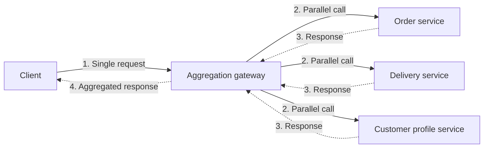

# Gateway Aggregation

## Description

The Gateway Aggregation pattern uses a gateway to aggregate several individual requests into a single request. Instead of the client directly calling each backend service needed to complete an operation, it sends one call to the gateway, which breaks it down, dispatches the calls to the corresponding services (preferably in parallel), and combines the responses into a single payload returned to the client.

This drastically reduces the "chattiness" between client and backend: the client makes one round trip over the network, while the many internal calls happen close to the services, on a low-latency network. The gateway also centralizes the handling of transient failures, timeouts, and partial responses, which would otherwise be scattered across all clients.

The aggregation can live in the gateway itself (lightweight composition, such as assembling and shaping responses) or in a dedicated aggregation service behind it, when there is domain logic, complex transformations, or longer orchestrations. As a one-off example, an API gateway such as Azure API Management can compose responses from several services through policies.

## Problems it solves

- Clients that need to make many calls to different services to perform a single task, consuming resources and connections on every request.
- Performance and scalability degradation caused by too many calls between client and backend, made worse in microservices architectures.
- Inefficiency and lost connectivity on high-latency networks (such as cellular networks), where multiple requests increase the chance of failure or incomplete responses.
- The need to change the client whenever a new service or feature becomes part of the operation.
- A broad exposure surface, with many services directly accessible by clients.

## When to use

- When a client needs to communicate with several backend services to perform an operation.
- When the client uses networks with significant latency, such as mobile networks.
- When you want to keep backend services isolated from the clients' network, exposing only a single entry point.
- When the backend needs to evolve (swap services or data sources) without affecting the contracts used by clients.

### When to avoid

- When the goal is to reduce the number of calls between a client and a single service across several operations; in that case, a batch operation on the service itself tends to be more appropriate.
- When the client or application is close to the backend services and latency isn't a relevant factor.
- When the aggregation would require heavy domain logic in the gateway, mixing routing, offloading, and business responsibilities.

## Trade-offs

| Benefit | Cost / Risk |
| --- | --- |
| Fewer round trips between client and backend, reducing perceived latency | The gateway adds an extra hop and can become a bottleneck if it doesn't scale with the load |
| Transient failure handling centralized instead of spread across clients | The gateway can become a single point of failure (SPoF) if it isn't designed for high availability |
| Smaller public surface and fewer authentication points; backends isolated from the network | Risk of introducing coupling between backend services within the aggregation logic |
| Backend evolves independently of clients | Need to decide on and document behavior in the face of partial responses or failures |
| Caching in the aggregation layer reduces calls to services | One more component to operate, load-test, and monitor |

- **Latency:** place the gateway close to the backend services and use asynchronous I/O and parallel calls so that one slow service doesn't hold up the whole response.
- **Resilience:** apply bulkheads, circuit breakers, retries, and per-call timeouts; run load tests to avoid cascading failures.
- **Partial responses:** explicitly define whether the operation returns partial data when a service exceeds its timeout or fails entirely when consistency is mandatory.
- **Cache as failover:** consider returning cached data when a backend is unavailable.
- **Separation of concerns:** prefer an aggregation service behind the gateway when the aggregation has different resource requirements from the routing and offloading functions.
- **Observability:** use distributed tracing with correlation IDs to follow each individual call, and monitor request metrics, per-dependency latency, and response sizes.

## Diagram

The client sends a single request to the gateway, which fires parallel calls to the backend services, combines the results, and returns a single response. The services stay hidden from the client and the multiple calls happen inside the low-latency network.

## Related patterns

- [Backends for Frontends](/cloud/cloud-design-patterns/gateways-and-edge/backends-for-frontends) — each frontend can have its own gateway that aggregates data according to the client's specific needs.
- [Gateway Offloading](/cloud/cloud-design-patterns/gateways-and-edge/gateway-offloading) — moves cross-cutting features (TLS, authentication) to the gateway, often combined with aggregation.
- [Gateway Routing](/cloud/cloud-design-patterns/gateways-and-edge/gateway-routing) — routes requests to several services through a single endpoint; aggregation goes further by combining the responses.
- [Circuit Breaker](/cloud/cloud-design-patterns/resiliency/circuit-breaker) — keeps the gateway from continuing to call a failing service and causing cascading failures.
- [Retry](/cloud/cloud-design-patterns/resiliency/retry) — handles transient failures centrally in the calls made by the gateway.
- [Bulkhead](/cloud/cloud-design-patterns/resiliency/bulkhead) — isolates resources per backend service so that one service's slowness doesn't exhaust the gateway.
- [Cache-Aside](/cloud/cloud-design-patterns/data-management/cache-aside) — allows serving cached data in the aggregation layer, reducing calls and serving as failover.

## Reference

- [Azure Architecture Center documentation](https://learn.microsoft.com/en-us/azure/architecture/patterns/gateway-aggregation)
