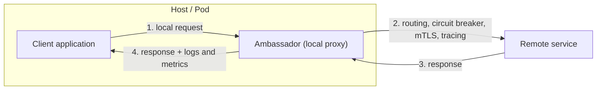

# Ambassador

## Description

The Ambassador pattern creates helper services that send network requests on behalf of a consumer application or service. The ambassador acts as an out-of-process proxy deployed alongside the application (on the same host, VM, or pod), so the application talks only to this local proxy instead of calling remote services directly.

This moves cross-cutting client connectivity tasks, such as monitoring, logging, routing, encryption (TLS/mTLS), authentication, and resiliency patterns (retry, circuit breaker), out of the application code and into a language-independent component. The ambassador can be updated, configured, and operated separately, often by teams specialized in networking, security, or platform.

The ambassador can be deployed as a sidecar that follows the application's lifecycle, as a daemon or system service shared by several processes on the same host, or, in containerized environments, as a separate container next to the application container.

## Problems it solves

- Legacy or hard-to-modify applications that need modern connectivity features (circuit breaking, routing, metrics, network configuration updates).
- Repeated connection, authentication, and authorization setup across multiple applications written in different languages and frameworks.
- The risk of a central network or security team having to change code in applications it doesn't know.
- Lack of standardized instrumentation (latency, resource usage, tracing) on outbound calls.
- The need to apply security controls (encryption, mutual authentication) that the client can't implement directly.

## When to use

- When you need to build a common set of client connectivity features for multiple languages or frameworks.
- When cross-cutting connectivity concerns should be delegated to infrastructure or other specialized teams.
- When a legacy or hard-to-change application needs to meet cloud or cluster connectivity requirements.
- When you need to support protocols or connectivity patterns that API gateways, service meshes, or standard ingress and egress controls don't handle easily.

### When to avoid

- When network request latency is critical and even the small overhead of the proxy is unacceptable.
- When the connectivity features are consumed by a single language; a client library distributed as a package tends to be simpler.
- When the connectivity features can't be generalized and require deep integration with the application logic.
- When the platform already offers ready-made solutions, such as a service mesh, for mTLS, traffic management, and policies; prefer them over a custom ambassador.

## Trade-offs

| Benefit | Cost / Risk |
| --- | --- |
| Resiliency (retry, circuit breaker, buffering) applied without changing the application | Added latency on every call because of the extra proxy hop |
| Network security (TLS/mTLS, authentication) centralized and language-independent | One more component to package, deploy, version, and monitor |
| Specialized teams evolve networking and security without touching application code | Generic retries can be dangerous if operations aren't idempotent |
| Standardized instrumentation and telemetry on outbound calls | A shared instance becomes a single point of failure and contention; a per-client instance consumes more resources |

- **Context between client and proxy:** define a mechanism for the application to pass instructions to the ambassador, for example headers that disable retry or limit the number of attempts.
- **Deployment model:** choose between one instance per client (sidecar) or one instance shared per host, weighing isolation against resource consumption.
- **Idempotency:** only enable automatic retries for operations that can be safely repeated.
- **Observability:** the ambassador is a natural place to measure latency, log calls, and propagate tracing information.
- **Operational complexity:** the proxy's lifecycle (updates, configuration, health) must be managed together with the application's.

## Diagram

The application sends its requests to the ambassador colocated on the same host, which resolves the destination, applies resiliency and security, forwards the call to the remote service, and returns the response, recording metrics such as latency. As a specific example, on Azure Kubernetes Service the ambassador usually runs as a sidecar container in the same pod as the application.

## Related patterns

- [Sidecar](/cloud/cloud-design-patterns/integration-and-modernization/sidecar) — the ambassador is a specialization of the sidecar focused on outbound connectivity and is often deployed that way.
- [Circuit Breaker](/cloud/cloud-design-patterns/resiliency/circuit-breaker) — one of the most common resiliency features to implement inside the ambassador.
- [Retry](/cloud/cloud-design-patterns/resiliency/retry) — the ambassador can apply retries transparently, as long as the operations are idempotent.
- [Gateway Offloading](/cloud/cloud-design-patterns/gateways-and-edge/gateway-offloading) — also offloads cross-cutting concerns, but centrally on the server side rather than next to the client.
- [Anti-Corruption Layer](/cloud/cloud-design-patterns/integration-and-modernization/anti-corruption-layer) — also sits between the application and external systems, but to translate semantics rather than handle connectivity.

## Reference

- [Azure Architecture Center documentation](https://learn.microsoft.com/en-us/azure/architecture/patterns/ambassador)
