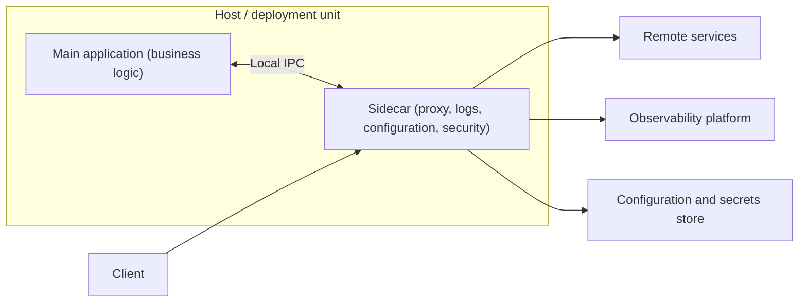

# Sidecar

## Description

The Sidecar pattern deploys an application's helper components in a separate process or container that runs alongside the main application. Like a motorcycle sidecar, this component is attached to the "parent" application and shares its lifecycle: both are created and removed together. The pattern is also known as *Sidekick*.

The main application handles the business functionality, while the sidecar takes over peripheral and cross-cutting tasks, such as logging, monitoring, configuration, network proxying, encryption in transit, and abstraction of platform services. Each application instance gets its own sidecar instance, which runs on the same host and communicates with it through a local inter-process communication mechanism (for example, HTTP or gRPC on localhost).

Because the sidecar is independent of the application's language and runtime, a single implementation can serve services written in different technologies, offering a consistent interface to platform capabilities. The most common implementation uses containers, but the concept applies to any co-deployed process.

## Problems it solves

- Cross-cutting features (logging, metrics, configuration, networking) implemented inside the application process with no isolation: a failure in them brings down the entire application.
- The need to reimplement platform libraries in each language used by the services, causing duplication and inconsistency.
- Latency and deployment complexity when moving these features to independent remote services.
- Legacy applications, or ones without native extension mechanisms, that need new capabilities (for example, mutual TLS, telemetry collection) without code changes.
- Cross-cutting security controls applied unevenly across components.

## When to use

- The main application uses diverse languages and frameworks and needs a uniform interface to common capabilities.
- A component belongs to another team or an external partner and must evolve independently.
- The component needs to run on the same host as the application (for example, to access the same local resources).
- You need a service that shares the application's lifecycle but can be updated separately.
- You want fine-grained control of resource limits (CPU, memory) for a specific component, isolated from the application.
- You need to add observability or security controls without coupling dependencies to the application code.

### When to avoid

- Inter-process communication needs to be highly optimized; the sidecar's overhead, especially in latency, hurts very frequent interactions.
- The application is small and the resource cost of one sidecar per instance outweighs the benefits of isolation.
- The component needs to scale independently of the application; in that case, prefer a separate service.
- The platform already natively offers the desired functionality, making the sidecar unnecessary complexity.
- The available service mesh offers a sidecar-less data plane that meets the requirements at lower cost.

## Trade-offs

| Benefit | Cost / Risk |
| --- | --- |
| Fault and resource isolation between the application and helper features | Extra CPU and memory consumption on every instance |
| Language independence and reuse of the same implementation | Added latency in inter-process communication |
| Reduced attack surface and uniform security controls | More components to deploy, version, and monitor |
| Sidecar can be updated independently of the application | Need to coordinate startup and shutdown order |
| Built-in observability without changing the code | Scale is always coupled to that of the main application |

- **Lifecycle:** make sure the sidecar starts before and terminates after the application to avoid race conditions; some orchestration platforms offer native support for this.
- **Communication:** prefer IPC mechanisms that are language- and framework-agnostic, unless performance requirements demand something more specific.
- **Alternatives:** assess whether the functionality would be better as a separate service, a traditional daemon, or a language-specific library (deeper integration and less network overhead).
- **Packaging:** containers are the most natural format, but the decision should take the platform's deployment model into account.
- **Cost and operational complexity:** the number of sidecars grows linearly with instances, affecting cost and version management.

## Diagram

The main application and the sidecar run side by side on the same host, sharing lifecycle and resources. The sidecar mediates traffic and handles the cross-cutting concerns, such as calls to remote services, sending telemetry, and fetching configuration, without the application needing to know these details.

## Related patterns

- [Ambassador](/cloud/cloud-design-patterns/integration-and-modernization/ambassador) — a specialization of the Sidecar, acting as an outbound proxy for connectivity to remote services.
- [Gateway Offloading](/cloud/cloud-design-patterns/gateways-and-edge/gateway-offloading) — also offloads cross-cutting concerns, but centrally in a gateway rather than per instance.
- [Messaging Bridge](/cloud/cloud-design-patterns/messaging/messaging-bridge) — a sidecar can act as a protocol adapter or bridge between messaging systems.
- [Anti-Corruption Layer](/cloud/cloud-design-patterns/integration-and-modernization/anti-corruption-layer) — a sidecar can isolate the application from legacy or incompatible interfaces.
- [Circuit Breaker](/cloud/cloud-design-patterns/resiliency/circuit-breaker) and [Retry](/cloud/cloud-design-patterns/resiliency/retry) — commonly implemented in network proxy sidecars, without changing the application code.
- [Health Endpoint Monitoring](/cloud/cloud-design-patterns/resiliency/health-endpoint-monitoring) — sidecars can expose or run health checks on behalf of the application.
- [External Configuration Store](/cloud/cloud-design-patterns/deployment-and-topology/external-configuration-store) — the sidecar can fetch external configuration and deliver it to the application.

## Reference

- [Azure Architecture Center documentation](https://learn.microsoft.com/en-us/azure/architecture/patterns/sidecar)
