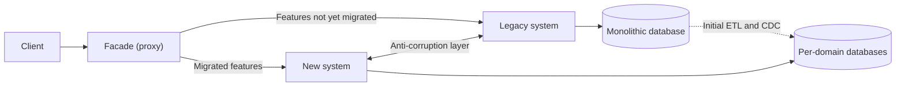

# Strangler Fig

## Description

The Strangler Fig pattern incrementally migrates a legacy system by replacing specific pieces of functionality, one by one, with new applications and services. As features are migrated, the new system comes to cover everything the old one did, until the legacy system can be decommissioned. The name comes from the strangler fig, which grows around a host tree until it replaces it.

The core mechanism is a facade (proxy) placed between the clients and the systems. It intercepts requests and decides, feature by feature, whether each one goes to the legacy system or the new one. Clients keep using the same interface and don't notice that a migration is underway.

The migration happens in phases: at the start, the facade forwards almost everything to the legacy system; with each iteration, more routes move to the new system; when no dependencies remain, the legacy system is decommissioned; finally, the facade can be removed and clients talk directly to the new system (or it can stay on as an adapter for old clients).

From the microservices.io perspective (Strangler Application), the question is how to migrate a legacy monolith to microservices. The answer is to build, around the monolith, a new application with a microservices architecture containing two kinds of services: those that take over functionality previously in the monolith and those that add new functionality. The latter are especially valuable, since they show the business the value of microservices early, without depending on the migration being finished.

## Problems it solves

- Aging systems, built on obsolete tools, hosting, and architectures, that become harder and harder to maintain and evolve.
- The high risk of rewriting and replacing an entire complex system all at once ("big bang").
- The need for clients to know which version of the system serves each feature when two versions run in parallel.
- Disruptions for clients every time a feature moves during modernization.
- How to migrate a legacy monolith to a microservices architecture without halting the delivery of business value.
- Monolithic databases shared by multiple domains, hard to decompose without a gradual strategy.

## When to use

- When gradually migrating a back end to a new architecture, especially when replacing large systems, key components, or complex features is risky.
- When the original system can continue to exist for an extended period during the migration.
- When you want to prioritize higher-return (ROI) replacements before lower-return ones, leveraging the investment already made in the current system.
- When decomposing a monolith into services with well-defined domain boundaries.

### When to avoid

- When it isn't possible to intercept the requests destined for the back end.
- When you have no access to the legacy source code or to another modifiable integration point (such as the database) to disable migrated features and redirect internal calls.
- In small systems, where full replacement is simple.
- When the original system needs to be decommissioned quickly.

## Trade-offs

| Benefit | Cost / Risk |
| --- | --- |
| Incremental migration reduces risk compared to a full replacement | Longer migration, with two systems running in parallel |
| Clients aren't impacted: same interface throughout the process | The facade can become a single point of failure or a performance bottleneck |
| Leverages existing investment and allows prioritizing by ROI | Temporary infrastructure cost of the transitional architecture |
| Per-feature rollback is possible while the legacy system exists | Complexity of managing data and dependencies shared between the systems |
| Continuous improvement with small deliveries and safe deployments | The facade must be kept in sync with the migration's progress |

- **Data consistency:** services and databases used by both systems must support simultaneous access; when extracting domains, use an initial load (ETL) and change data capture (CDC), validating consistency before the cutover.
- **Cross dependencies:** the new system may need to call parts not yet migrated, and vice versa; an anti-corruption layer keeps the new design from inheriting the legacy semantics.
- **Unmodifiable legacy:** in database-centric applications, triggers or CDC can notify the new services without changing the application code.
- **New features as services:** instead of adding code to the monolith, implement them as new microservices behind the facade; this reduces legacy growth and demonstrates the architecture's value early.
- **Future design:** structure the new services with clear boundaries so that they themselves can be replaced the same way in the future.
- **Reversibility:** treat the removal of legacy objects as a deliberate final step, executed only after the new system has been validated.
- **Observability:** monitor the facade and compare behavior between the legacy and new systems on each migrated route.

## Diagram

The client talks only to the facade, which forwards each request to the legacy or the new system depending on the migration state. Over time, all routes point to the new system, the data is extracted into per-domain databases, and the legacy system (and, optionally, the facade) is decommissioned.

## Related patterns

- [Database per Service](/architecture/microservices/service-collaboration/database-per-service) — the destination for the data of each domain extracted from the monolithic database.
- [Anti-Corruption Layer](/cloud/cloud-design-patterns/integration-and-modernization/anti-corruption-layer) — translates calls between the new system and the legacy one during coexistence, protecting the new design from legacy semantics.
- [Gateway Routing](/cloud/cloud-design-patterns/gateways-and-edge/gateway-routing) — the Strangler Fig facade is essentially gateway routing to direct requests to the right system.
- [Backends for Frontends](/cloud/cloud-design-patterns/gateways-and-edge/backends-for-frontends) — can serve as a client-type-specific facade during the migration.
- [Materialized View](/cloud/cloud-design-patterns/data-management/materialized-view) — helps expose legacy data to the new system while domains are being extracted.
- [Event Sourcing](/cloud/cloud-design-patterns/data-management/event-sourcing) — change events can feed data synchronization between the legacy and new systems.
- [Circuit Breaker](/cloud/cloud-design-patterns/resiliency/circuit-breaker) — protects the facade and the new system from failures in the legacy system that is still in use.

## Reference

- [Azure Architecture Center documentation](https://learn.microsoft.com/en-us/azure/architecture/patterns/strangler-fig)
- [Strangler Application on microservices.io](https://microservices.io/patterns/refactoring/strangler-application.html)
