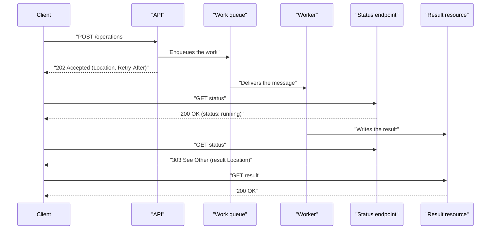

# Asynchronous Request-Reply

## Description

The Asynchronous Request-Reply pattern decouples back-end processing from the front-end host when the work has to run asynchronously but the client still needs a clear response. Instead of keeping the connection open until a long operation finishes, the API validates the request, hands it off for background processing (for example, through a queue), and immediately responds with HTTP 202 (Accepted).

The 202 response carries a `Location` header pointing to a status endpoint and, optionally, a `Retry-After` header suggesting the polling interval. The client polls that endpoint, which returns HTTP 200 with the operation's current state (pending, running, completed, failed, canceled). When the work is done, the status endpoint either returns the result or redirects with HTTP 303 (See Other) to the final resource, which the client fetches with a GET.

The pattern is mainly useful when the client can't receive callbacks (webhooks, WebSockets) and the operation takes seconds, minutes, or longer. It works both between a browser and a server and between services in a microservices architecture.

## Problems it solves

- Long-running operations that exceed HTTP, gateway, or load balancer connection timeouts
- Clients blocked waiting for slow responses, tying up connections and threads on the server
- Being unable to send callbacks to the client because of firewall, NAT, or environment constraints (for example, code running in a browser)
- Coupling between the rate of incoming requests and the back end's processing capacity
- The client having no visibility into the progress and outcome of background work

## When to use

- Client-side code, such as browser applications, where exposing callback endpoints is hard or long-lived connections add too much complexity
- Calls to services that only use HTTP and can't send callbacks because of client network restrictions
- Integration with workloads that don't support modern notification mechanisms such as WebSockets or webhooks
- Long-running operations (report generation, file processing, resource provisioning) exposed through a REST API

### When to avoid

- When you already have a dedicated service for asynchronous notifications (for example, an event bus such as Azure Event Grid)
- When responses must be streamed in real time; Server-Sent Events (SSE) offer a simple push channel without polling
- When the client has to collect many results and their latency matters; a message broker tends to be a better fit
- When persistent server-side connections (such as WebSockets) are available to notify the caller
- When the network allows opening ports to receive callbacks or webhooks
- When the operation is fast enough to respond on the same connection

## Trade-offs

| Benefit | Cost / Risk |
| --- | --- |
| Immediate response and better perceived responsiveness | The client has to implement polling and handle intermediate states |
| Independent scaling of the API and the processors | More components: queue, workers, status storage |
| Higher concurrency; the server schedules work according to capacity | Excessive polling adds load if `Retry-After` is ignored |
| Avoids timeouts on long operations | Extra latency between completion and the client noticing it |
| Progress visibility through the status endpoint | Status and result resources must be retained and cleaned up |

- **Idempotency:** require an idempotency key (for example, an `Idempotency-Key` header) so that resubmitted POSTs return the existing status instead of creating duplicate work.
- **HTTP semantics:** prefer a dedicated status endpoint (200 with a status body) over polling the final resource and getting a 404, which is ambiguous. Use 303 instead of 302 for the redirect, so clients don't repeat the original method.
- **Status body:** include fields such as `status`, `createdAt`, `lastUpdatedAt`, `percentComplete`, and a structured `error` (for example, RFC 9457).
- **Early validation:** validate the request before enqueuing it and respond with 400 (Bad Request) right away if it's invalid.
- **Cancellation:** expose DELETE on the status resource to forward the cancellation to the back end; consider partial rollback or a compensating transaction.
- **Retention and cost:** define an expiration policy for status and result resources (the `Expires` header can communicate it).
- **Security:** the `Location` can point to a URL with a limited-access token (Valet Key).
- **Legacy clients:** you may need a facade that hides the asynchronous processing from clients that only make synchronous calls.
- **Observability:** correlate the request ID across the API, queue, workers, and status endpoint.

## Diagram

The client receives a 202 as soon as the request is accepted and enqueued, polls the status endpoint while respecting `Retry-After`, and, once the work is complete, is redirected with a 303 to fetch the final result.

## Related patterns

- [Queue-Based Load Leveling](/cloud/cloud-design-patterns/messaging/queue-based-load-leveling) — the queue between the API and the workers decouples and levels the load of asynchronous processing.
- [Competing Consumers](/cloud/cloud-design-patterns/messaging/competing-consumers) — multiple workers can consume the queue in parallel to scale processing.
- [Valet Key](/cloud/cloud-design-patterns/security-and-access/valet-key) — lets the `Location` point to the result with restricted, temporary access.
- [Idempotent Consumer](/cloud/cloud-design-patterns/messaging/idempotent-consumer) — protects against duplicate processing when the client resubmits the request.
- [Retry](/cloud/cloud-design-patterns/resiliency/retry) — the client should retry calls with backoff, respecting `Retry-After`.
- [Compensating Transaction](/cloud/cloud-design-patterns/distributed-coordination/compensating-transaction) — useful for undoing partial work when a long-running operation is canceled.
- [Claim-Check](/cloud/cloud-design-patterns/messaging/claim-check) — large payloads can be stored separately and referenced in the queued message.
- [Backends for Frontends](/cloud/cloud-design-patterns/gateways-and-edge/backends-for-frontends) — a BFF can encapsulate the polling or act as a facade for clients that expect synchronous responses.

## Reference

- [Documentation in the Azure Architecture Center](https://learn.microsoft.com/en-us/azure/architecture/patterns/asynchronous-request-reply)
