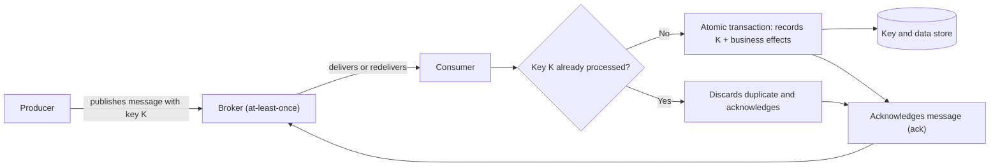

# Idempotent Consumer

## Description

The Idempotent Consumer pattern designs message consumers so that processing the same message more than once has exactly the same effect as processing it a single time. Since most brokers offer *at-least-once* delivery, duplicates are unavoidable; instead of trying to eliminate them at delivery time, the consumer learns to tolerate them, achieving *effectively-once* processing.

In Enterprise Integration Patterns (Hohpe and Woolf), the pattern is called Idempotent Receiver. The book presents it as the answer to the fact that a message can arrive more than once even if the sender sent it only once, and describes two strategies: explicitly detecting and discarding duplicates, or designing message semantics so that reprocessing is harmless (for example, messages that carry absolute state rather than an increment).

The consumer extracts a stable deduplication key from each message (an identifier assigned by the producer or a business idempotency key) and checks a persistent store of already-processed keys. If the key already exists, the message is acknowledged and discarded as a duplicate, optionally returning the previously recorded result. Otherwise, the message is processed and the key is recorded in the same atomic operation, and only then is the message acknowledged.

There are two common ways to store the identifiers: in a dedicated processed-messages table (for example, `PROCESSED_MESSAGES`, with a primary key composed of the subscriber identifier and the message identifier, so the insert fails if the message was already processed) or in the business entities the consumer creates or updates. On a duplicate, the transaction is rolled back and the message is ignored.

In the Patterns of Distributed Systems catalog (Unmesh Joshi), Idempotent Receiver addresses the same problem between a client and a server in a cluster, when the client doesn't know whether a request that got no response was lost or processed, and resends it. The solution is a client registry: the server assigns each client a unique ID, and each request carries a sequence number within that client. The server stores the response for each processed request, indexed by client and number, and when it receives a repeat it returns the stored response without executing the operation again. In a cluster with a Replicated Log, the client registry and the responses are replicated like any other entry, so a new leader also recognizes duplicates. Because the storage can't grow without bound, records expire: responses to requests the client has already confirmed receiving are discarded, and clients that have been inactive for some time are removed from the registry (and have to register again).

For this to work under concurrency, correctness is guaranteed by the data store (a uniqueness constraint, a conditional insert, or *set-if-absent*) and not by a check followed by a write in the application. When the key registration and the business effects are written in the same transaction, the variant is known as *Inbox*, the consumer-side counterpart of the *Transactional Outbox*.

## Problems it solves

- Producer resends after a timeout or transient network failure, which put two copies of the same message on the broker.
- Redelivery by the broker when the acknowledgment (*ack*) is lost, the *lock* expires, or the consumer crashes before acknowledging.
- A consumer that finishes writing to the database but fails before the *ack*, causing another instance to repeat the operation.
- Unwanted side effects of duplicates: duplicate records, double-charging a customer, repeated notifications.
- Competing consumers receiving copies of the same message at the same time.
- In replicated clusters, clients that resend a request after a timeout or leader change without knowing whether it was applied, which requires registering clients and responses by request number (Joshi's view).
- In microservices, where *at-least-once* brokers are preferred for reliability, redelivery is expected: non-idempotent consumers (for example, one that subtracts the amount of an `AccountDebited` event from a balance) would compute incorrect results when processing a duplicate.

## When to use

- The consumer reads from a broker with *at-least-once* delivery, which is the default for most brokers.
- Reprocessing a message can produce incorrect results, such as duplicate financial transactions, duplicate resource creation, or repeated notifications.
- Multiple competing consumers process the same channel, increasing the chance of simultaneous duplicates.
- Outside of messaging: ETL pipelines that reprocess data, stream processing resumed from a *checkpoint*, scheduled jobs that overlap or restart, and webhook/HTTP endpoints that receive duplicate deliveries.

### When to avoid

- The consumer's operations are already naturally idempotent (for example, an *upsert* by business identifier, writing an absolute value instead of an increment, a `PUT` on a resource), making the deduplication bookkeeping a cost with no benefit.
- The workload tolerates the effects of occasional duplicates, and the cost of maintaining a deduplication store outweighs the impact of a duplicate.

## Trade-offs

| Benefit | Cost / Risk |
| --- | --- |
| Lets you use *at-least-once* delivery and retries safely, without corrupting data | Requires a persistent store of processed keys, with storage cost and an extra write per message |
| Duplicates stop being a correctness risk and become a tolerated condition | Implementing storage, atomic commit, and cleanup correctly is error-prone |
| Supports competing consumers without double processing | Choosing the wrong key (transport identifiers, timestamps, *correlation ids*) defeats deduplication |
| Eases recovery after failures, since reprocessing is safe | External effects that don't participate in the transaction require a two-phase flow (*in-progress* / *completed*) and reconciliation of pending records |

Additional considerations:

- **Prefer natural idempotency:** design operations as *upserts* or use *event-carried state transfer* (the message carries the resulting absolute state), and reserve deduplication for whatever can't be made naturally idempotent.
- **Atomicity:** write the deduplication marker and the business effects in the same transaction; writing them in separate steps opens a window where a crash leaves the effect applied and the key unrecorded.
- **Concurrency:** use a uniqueness constraint or an atomic conditional write; the "check, then write" pattern on a cache has a race condition.
- **Multiple subscribers:** in *publish-subscribe* with shared storage, use a composite key (consumer identity + message identity) so one consumer doesn't suppress processing by the others.
- **Record lifecycle:** define a TTL longer than the broker's maximum redelivery window (delivery attempts, *lock*/visibility, message TTL) and consider manual resends from *dead-letter queues*.
- **Broker deduplication doesn't replace the pattern:** features such as Azure Service Bus duplicate detection work at send time and within a limited window; they help reduce volume but don't prevent reprocessing after redelivery.
- **Ordering:** deduplication doesn't guarantee order; combine it with ordered sessions/partitions or version/sequence data to reject stale messages.
- **Content conflict:** if the key already exists but the content differs, send it to the *dead-letter* queue and raise an alert instead of silently discarding it.
- **Observability:** record the deduplication key and the correlation identifier in structured logs and track a metric for detected duplicates; an increase can point to producer issues, an undersized *ack* window, or unstable consumers.
- **Propagation:** pass the idempotency key on to downstream services, so each layer can deduplicate its own work.
- **Frameworks:** messaging frameworks often provide this functionality out of the box (deduplication, retention, and cleanup), reducing the risk of a hand-rolled implementation.

## Diagram

The consumer checks the deduplication key and, if it's new, writes the key and the business effects in the same atomic transaction before acknowledging. When the same message arrives again, the key already exists (guaranteed by a uniqueness constraint in the store), and the consumer simply acknowledges and discards the duplicate without repeating the effects.

## Related patterns

- [Guaranteed Delivery](/architecture/eip/messaging-channels/guaranteed-delivery) — the channel's guaranteed delivery is what makes duplicates possible and the idempotent receiver necessary (EIP).
- [Command Message](/architecture/eip/message-construction/command-message) — redelivered commands are the typical case where idempotency matters (EIP).
- [Competing Consumers](/cloud/cloud-design-patterns/messaging/competing-consumers) — multiple competing consumers increase the chance of simultaneous duplicates, which the Idempotent Consumer handles safely.
- [Retry](/cloud/cloud-design-patterns/resiliency/retry) — retries from producers and consumers are one of the main sources of duplicates; idempotent consumers make retries safe.
- [Publisher-Subscriber](/cloud/cloud-design-patterns/messaging/publisher-subscriber) — each subscriber receives its own copy and must track processing independently.
- [Queue-Based Load Leveling](/cloud/cloud-design-patterns/messaging/queue-based-load-leveling) — queues with *at-least-once* delivery require consumers that tolerate redelivery.
- [Sequential Convoy](/cloud/cloud-design-patterns/messaging/sequential-convoy) — complements deduplication when processing depends on order.
- [Compensating Transaction](/cloud/cloud-design-patterns/distributed-coordination/compensating-transaction) — compensation steps can also be re-executed and must be idempotent.
- [Saga](/cloud/cloud-design-patterns/distributed-coordination/saga) — saga steps coordinated through messages depend on idempotent participants.
- [Messaging (microservices)](/architecture/microservices/communication-styles/messaging) — an asynchronous communication style whose *at-least-once* broker makes the idempotent consumer necessary.
- [Transactional Outbox (microservices)](/architecture/microservices/transactional-messaging/transactional-outbox) — the producer-side counterpart; the *Inbox* is the consumer-side counterpart.
- [Replicated Log](/architecture/distributed-systems/data-replication/replicated-log) — the client registry and the stored responses are replicated in the log to survive a leader change (Patterns of Distributed Systems).
- [Request Waiting List](/architecture/distributed-systems/data-replication/request-waiting-list) — the leader tracks pending requests while waiting for the commit, and the client can retry them (Patterns of Distributed Systems).
- [Event Sourcing](/cloud/cloud-design-patterns/data-management/event-sourcing) — projections that reprocess events must apply each event exactly once.

## Reference

- [Documentation in the Azure Architecture Center](https://learn.microsoft.com/en-us/azure/architecture/patterns/idempotent-consumer)
- [Idempotent Consumer on microservices.io](https://microservices.io/patterns/communication-style/idempotent-consumer.html)
- [Idempotent Receiver on Enterprise Integration Patterns](https://www.enterpriseintegrationpatterns.com/IdempotentReceiver.html)
- [Idempotent Receiver in the Patterns of Distributed Systems catalog](https://martinfowler.com/articles/patterns-of-distributed-systems/idempotent-receiver.html)
