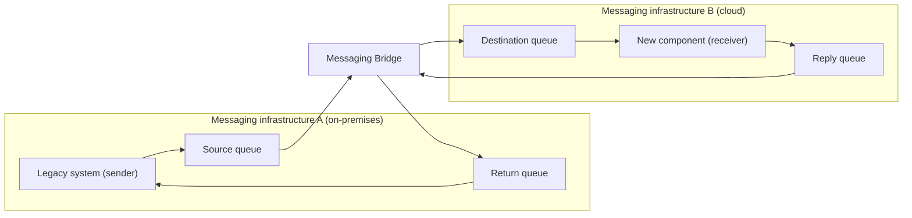

# Messaging Bridge

## Description

The Messaging Bridge connects systems that use different messaging infrastructures (for example, a legacy on-premises broker and a cloud queue service) and relays messages between them. This lets distinct systems be integrated without having to modify them.

Each system stays connected only to its own messaging infrastructure. An intermediary component, the *bridge*, connects to two or more infrastructures at the same time: it consumes messages from a source queue and publishes them to a destination queue on the other infrastructure, without changing the payload.

The integrated systems don't need to know about each other or about the bridge. The sender sends messages to a designated queue in its native infrastructure; the bridge picks them up and forwards them to the corresponding queue in the other infrastructure, where the receiver consumes them. The topology can use a single *bridge queue* per infrastructure or pairs of *shadow queues*, one for each destination queue, leaving the sender completely unaware of the bridge.

In the Enterprise Integration Patterns formulation (Hohpe and Woolf), the bridge doesn't link entire systems but corresponding channels: it's made up of pairs of Channel Adapters, where the other side of each adapter is a different messaging system, and each pair maps a channel in one system to a channel in the other. It's also part of the bridge's responsibility to convert the message format between the two systems and to tell apart channels used by regular clients from channels that exist only for traffic between the systems.

## Problems it solves

- Applications don't know which messaging system to connect to, and messages published in one system don't reach the others.
- Merging two messaging systems entirely is usually impractical; the link has to be made channel by channel.
- Organizations with multiple messaging infrastructures coexisting, usually because of mergers, acquisitions, or extending on-premises systems to the cloud.
- The need to integrate systems without rewriting them to use HTTP, which would require adding clients and handlers, retesting, and redeploying.
- The complexity of hosting, securing, and keeping highly available HTTP endpoints built only for integration.
- Frequent connectivity failures that, with synchronous calls, would require custom-built retry mechanisms.
- Migrating a distributed system from one messaging technology to another without having to move everything at once.

## When to use

- Integrating existing systems with minimal modification.
- Integrating legacy applications that can't use other messaging technologies.
- Extending on-premises applications with cloud-hosted components.
- Connecting geographically distributed systems when the network connection is unreliable.
- Incrementally migrating a distributed system from one messaging infrastructure to another, moving endpoints as the schedule allows.

### When to avoid

- One of the systems depends on a feature of one infrastructure that doesn't exist in the other.
- The integration is synchronous by nature and the initiating system needs an immediate response.
- There are specific functional or non-functional requirements (security, privacy) that the bridge can't meet.
- The data volume exceeds the capacity of the messaging infrastructures or makes messaging too expensive a solution.

## Trade-offs

| Benefit | Cost / Risk |
| --- | --- |
| Systems integrated without modification; endpoints ideally don't even know messages are being forwarded | Advanced features of one of the technologies may not be available on the bridged route |
| More reliable integration than HTTP, thanks to at-least-once delivery | The route has to respect the limitations of both technologies (e.g., a much smaller maximum message size in one of them) |
| Gradual migration between infrastructures, endpoint by endpoint | One more component to deploy, scale, monitor, and maintain |
| Extends the life of existing systems without rewrites | Possible duplicates require deduplication, especially if one side relied on distributed transactions |

- **Consistency:** if one of the systems relies on distributed transactions for correctness, the bridge must implement deduplication.
- **Availability and scale:** to meet SLOs, the bridge may need to be scaled out with competing consumers.
- **Failure handling:** the bridge should have its own retry policy so it doesn't mark messages as *poison* during infrastructure failures; a circuit breaker can pause forwarding.
- **Migration:** in-flight messages (including those in error queues awaiting reprocessing) must reach the migrated endpoint; keep the bridge until they've all been delivered.
- **Systems without messaging:** if a system doesn't use messaging and can't be changed, you can emulate a queue in a database table (for example, via change data capture) and bridge from it.
- **Observability:** monitor queue depth, forwarding latency, and rejected messages on both sides.

## Diagram

The legacy system publishes messages to its native infrastructure; the bridge consumes them and relays them, without changing the payload, to the corresponding queue in the other infrastructure, and does the same in the opposite direction. Neither side needs to know there's a bridge between them (in Microsoft's example, on-premises MSMQ is connected to Azure Service Bus).

## Related patterns

- [Channel Adapter](/architecture/eip/messaging-channels/channel-adapter) — the bridge's building block: a pair of adapters links one channel from each system.
- [Message Channel](/architecture/eip/messaging-channels/message-channel) — the channels the bridge connects.
- [Message Translator](/architecture/eip/message-transformation/message-translator) — converts the message format between the two systems.
- [Competing Consumers](/cloud/cloud-design-patterns/messaging/competing-consumers) — used to scale the bridge out and meet availability SLOs.
- [Retry](/cloud/cloud-design-patterns/resiliency/retry) — the bridge needs its own retry policy to handle transient failures without discarding valid messages as poison.
- [Circuit Breaker](/cloud/cloud-design-patterns/resiliency/circuit-breaker) — lets you pause forwarding when one of the infrastructures is unavailable.
- [Idempotent Consumer](/cloud/cloud-design-patterns/messaging/idempotent-consumer) — at-least-once delivery through the bridge can produce duplicates that consumers must tolerate.
- [Strangler Fig](/cloud/cloud-design-patterns/integration-and-modernization/strangler-fig) — both support incremental migration of legacy systems to new technologies.
- [Anti-Corruption Layer](/cloud/cloud-design-patterns/integration-and-modernization/anti-corruption-layer) — also isolates legacy systems from new ones, but by translating semantics, whereas the bridge relays messages without changing them.

## Reference

- [Documentation in the Azure Architecture Center](https://learn.microsoft.com/en-us/azure/architecture/patterns/messaging-bridge)
- [Pattern page on Enterprise Integration Patterns](https://www.enterpriseintegrationpatterns.com/MessagingBridge.html)
