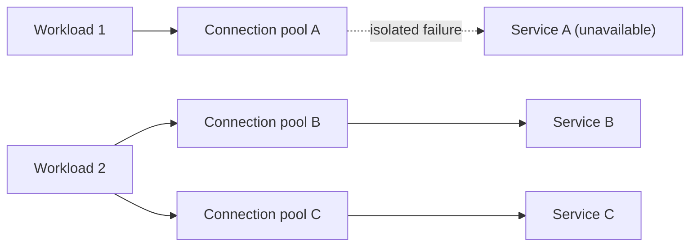

# Bulkhead

## Description

The Bulkhead pattern isolates the elements of an application into independent pools, so that if one of them fails, the others keep working. The name comes from the bulkheads that divide a ship's hull into watertight compartments: if the hull is punctured, only the damaged compartment fills with water, and the ship doesn't sink. The approach is also known as cell-based architecture.

Isolation can happen on two sides. On the service side, instances are partitioned into groups according to each consumer's load and availability requirements, so a client that generates excessive traffic exhausts only its own partition. On the consumer side, the resources used to call each dependency are kept separate, for example with a dedicated connection pool, thread pool, or semaphore per service. That way, a slow or unavailable dependency consumes only the resources reserved for it.

Partitions can be implemented with processes, threads, semaphores, containers, virtual machines, or distinct sets of queues, depending on the level of isolation you want. Each partition can be sized, monitored, and given its own service level independently.

## Problems it solves

- Cascading failures: a slow or misconfigured service holds on to consumer resources (such as connections from a shared pool) until they run out, preventing calls to every other service.
- Noisy neighbor: a single client with an excessive request volume exhausts the capacity of a shared service and degrades service for all other consumers.
- No differentiation of quality of service between critical consumers and regular consumers.
- Security incidents spreading between components that share the same resources.

## When to use

- When you need to isolate the resources used for specific dependencies, so that an outage in one service doesn't bring down the whole application.
- When critical consumers need to be isolated from regular consumers, with different service levels.
- When the application needs to be protected against cascading failures.
- In multi-tenant scenarios, to separate tenants (or groups of tenants) into distinct partitions.
- In AI and inference workloads subject to per-deployment quotas and concurrency limits, isolating model deployments by workload or by tenant.

### When to avoid

- When the less efficient use of resources (idle, reserved capacity in each partition) is not acceptable.
- When the added complexity of creating, operating, and monitoring multiple partitions isn't justified, as in small systems or those with few dependencies.

## Trade-offs

| Benefit | Cost / Risk |
| --- | --- |
| Failures are contained within the affected partition, avoiding a cascade effect | Resources reserved per partition tend to be underused |
| Part of the functionality remains available during failures | More components to deploy, configure, and operate |
| Allows distinct service levels per consumer or tenant | Defining the partition granularity requires business and technical analysis |
| Each partition scales independently | Wrong sizing of a pool can cause unnecessary rejections |
| Security incidents stay confined to the compromised compartment | Additional infrastructure cost depending on the chosen level of isolation |

- Define the partitions based on business and technical requirements; with domain-driven design, align them with bounded contexts.
- Weigh the isolation level offered by the technology (thread, process, container, virtual machine) against cost, performance, and manageability; containers usually offer a good balance.
- Combine with Retry, Circuit Breaker, and Throttling for more sophisticated failure handling.
- Monitor the performance and SLA of each partition separately.
- Prefer native platform controls (for example, rate limits in an API gateway such as Azure API Management, or resource limits in container orchestrators) over reimplementing isolation in code.

## Diagram

Each dependency gets its own resource pool. When Service A fails, only pool A is exhausted; Workload 2 keeps calling Services B and C normally.

## Related patterns

- [Circuit Breaker](/cloud/cloud-design-patterns/resiliency/circuit-breaker) — stops calls to a failing dependency, complementing resource isolation.
- [Retry](/cloud/cloud-design-patterns/resiliency/retry) — handles transient failures within each partition without affecting the others.
- [Throttling](/cloud/cloud-design-patterns/resiliency/throttling) — limits resource consumption per consumer, reinforcing isolation between partitions.
- [Rate Limiting](/cloud/cloud-design-patterns/resiliency/rate-limiting-pattern) — controls the volume of calls sent to each isolated dependency.
- [Queue-Based Load Leveling](/cloud/cloud-design-patterns/messaging/queue-based-load-leveling) — separate queues per partition help isolate services that communicate asynchronously.
- [Deployment Stamp](/cloud/cloud-design-patterns/deployment-and-topology/deployment-stamp) — applies the idea of independent cells at the level of a full deployment.
- [Sharding](/cloud/cloud-design-patterns/data-management/sharding) — partitions data, which also limits the reach of failures and overloads.

## Reference

- [Azure Architecture Center documentation](https://learn.microsoft.com/en-us/azure/architecture/patterns/bulkhead)
