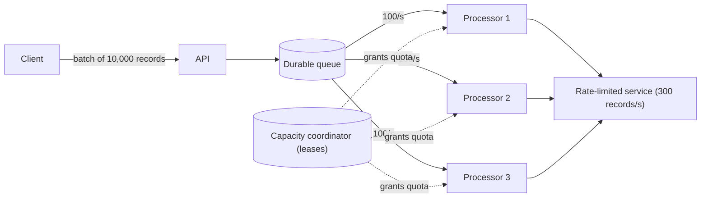

# Rate Limiting

## Description

The Rate Limiting pattern has an application **control the rate at which it sends requests** to a service that imposes usage limits. Instead of firing everything at once and resending whatever gets rejected, the client regulates its own consumption (number of operations, data volume, or relative cost per time interval) to stay within the target service's capacity. This avoids or reduces throttling errors and makes throughput and total processing time predictable.

The difference from [Throttling](/cloud/cloud-design-patterns/resiliency/throttling) lies in who does the controlling. In Throttling, the **service** protects itself and limits or rejects clients that go over (for example, by responding with HTTP 429). In Rate Limiting, the **client** knows and respects those limits in advance, consuming only what fits, so it isn't throttled. The two patterns complement each other: one sets the ceiling, the other stays below it.

A typical implementation puts requests into a durable messaging system able to absorb the total incoming rate, and uses one or more processors that read from it at a controlled pace. Releasing small batches more often (for example, 20 operations every 200 ms instead of 100 per second at once) makes the flow more uniform and avoids spikes. When several independent processes share the same service, capacity can be divided into logical partitions, and each process obtains exclusive, temporary leases on them through a distributed mutual exclusion mechanism (for example, blob leases in Azure Storage, ZooKeeper, etcd, or Redis).

## Problems it solves

- Excess throttling errors when running large volumes of operations against a limited service
- Traffic multiplied by resends: in the "try and resend whatever fails" style, 10,000 records can turn into 30,000 sends
- Extra cost of logging and processing thousands of errors
- Inability to estimate how long a batch process will take
- High memory consumption from buffering data the service can't yet accept, with a risk of loss if the process crashes
- Uncoordinated competition for capacity among several processes or applications using the same service

## When to use

- To reduce throttling errors from a service with known limits (requests/s, volume/min, cost units/s)
- In automated, repetitive, large-scale tasks, such as batch processing and data ingestion
- To reduce traffic compared with naive resend-after-error approaches
- To reduce memory usage, dequeuing only what can be processed in the current interval
- When you need to predict a job's throughput and duration

### When to avoid

- When the operation requires immediate, synchronous completion with very low latency and can't tolerate queuing or deferred processing
- When the bottleneck isn't the request rate but concurrency or resource contention (saturated CPU, long-running work in progress). In those cases, scaling or concurrency control works better
- When volume is low and sporadic and the service's limits are practically never reached

## Trade-offs

| Benefit | Cost / Risk |
| --- | --- |
| Fewer throttling errors and fewer resends | More components: durable queue, processors, coordination |
| Stable, predictable throughput | Higher per-item latency, since work sits in a queue |
| Lower memory, network, and CPU usage on the client | Requires knowing, configuring, and keeping the service's limits up to date |
| Efficient use of the contracted capacity | Distributed coordination (leases, partitions) brings complexity and new failure modes |
| Isolation between workflows with their own quotas | Capacity reserved per workflow can sit idle |

- **Residual errors:** even with Rate Limiting, the application must handle the throttling errors that still occur.
- **Coordinated retries:** retries should respect the limiter and backpressure signals (for example, HTTP 429 with `Retry-After`), with a bounded number of attempts and small random delays, to avoid retry storms.
- **All workflows:** bulk loads and queries that use the same service must go through the same mechanism or have separate quotas.
- **External contention:** other applications may consume the same capacity. An unexpected increase in errors can indicate contention and call for a temporary rate reduction.
- **Lease expiration:** the process must track lease deadlines and slow down when they expire.
- **Observability:** monitor effective rate, queue size, 429 errors, and wait time to tune the parameters.

## Diagram

The API accepts the entire load and writes it to a durable queue. The processors pull items at a controlled pace, according to the quota they obtained from the coordinator, so that the sum of the rates never exceeds the target service's limit.

## Related patterns

- [Throttling](/cloud/cloud-design-patterns/resiliency/throttling) — the service side: imposes the limits that Rate Limiting makes the client respect
- [Retry](/cloud/cloud-design-patterns/resiliency/retry) — handles the transient failures that still occur; should be coordinated with the limiter to avoid retry storms
- [Circuit Breaker](/cloud/cloud-design-patterns/resiliency/circuit-breaker) — stops calls when the service is degraded, complementing rate control
- [Queue-Based Load Leveling](/cloud/cloud-design-patterns/messaging/queue-based-load-leveling) — uses a queue to absorb spikes and deliver the load at a steady pace, the basis of the Rate Limiting implementation
- [Competing Consumers](/cloud/cloud-design-patterns/messaging/competing-consumers) — several processors consume the same queue and share the available capacity
- [Leader Election](/cloud/cloud-design-patterns/distributed-coordination/leader-election) — also uses distributed mutual exclusion (leases) to coordinate independent processes
- [Bulkhead](/cloud/cloud-design-patterns/resiliency/bulkhead) — isolates capacity per workflow, such as reserving separate quotas per type of load
- [Asynchronous Request-Reply](/cloud/cloud-design-patterns/messaging/asynchronous-request-reply) — decouples accepting the request from deferred, controlled processing

## Reference

- [Azure Architecture Center documentation](https://learn.microsoft.com/en-us/azure/architecture/patterns/rate-limiting-pattern)
