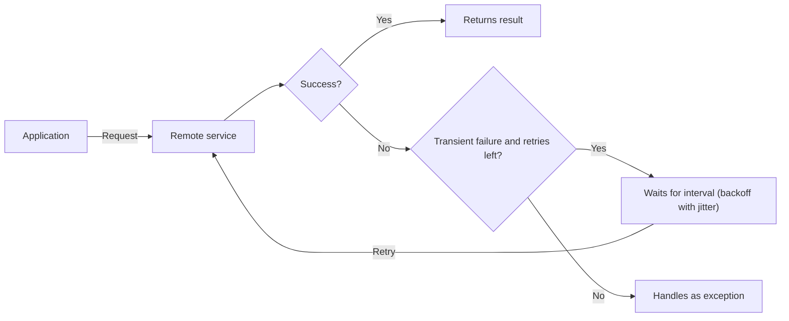

# Retry

## Description

The Retry pattern lets an application handle transient failures when connecting to a remote service or resource by transparently repeating an operation that failed. In distributed environments, momentary loss of connectivity, temporary service unavailability, or timeouts caused by overload are expected and generally correct themselves within a short time.

When a request fails, the application classifies the error and chooses a strategy: **cancel** (the failure isn't transient), **retry immediately** (a rare, one-off failure, such as a corrupted packet), or **retry after a delay**, which can grow incrementally or exponentially, preferably with random variation (jitter) to spread out requests from multiple instances. If the operation keeps failing after the maximum number of attempts, the failure is handled as an exception.

The retry logic is usually encapsulated in a reusable policy (maximum number of attempts, interval, types of errors that trigger a new attempt), and different services can have different policies. Many client libraries and cloud SDKs already offer this mechanism built in and configurable.

## Problems it solves

- Intermittent network failures that break operations that would succeed seconds later
- Services that temporarily reject requests because they're overloaded or applying throttling
- Sporadic timeouts on remote dependencies (databases, APIs, queues, storage)
- Transient errors needlessly propagated to the user or the business process, reducing perceived stability

## When to use

- When the application interacts with remote services or resources subject to transient, short-lived failures
- When repeating a failed request has a real chance of succeeding on a later attempt
- When the operation is idempotent, or can be made idempotent, so that repeating it is safe
- In batch or background processing, which tolerates more attempts with longer intervals

### When to avoid

- When the failure is likely to be long-lasting: retrying only wastes time and resources and hurts responsiveness (prefer a Circuit Breaker)
- For failures that aren't transient, such as business logic, validation, or authorization errors
- As a substitute for fixing scalability problems: frequent overload failures indicate the service needs to scale or be partitioned
- When there are several nested layers with retry, which multiplies attempts and produces long delays

## Trade-offs

| Benefit | Cost / Risk |
| --- | --- |
| Greater resilience to transient failures without manual intervention | Increased perceived latency while attempts are in progress |
| Fewer errors exposed to the user and to business processes | Aggressive policies can overload an already degraded service even further (retry storm) |
| Simple to implement and often available in libraries | Non-idempotent operations can run more than once, with side effects |
| Policies tunable per operation and error type | Retries nested across several layers multiply attempts and delays |

- **Fit to context:** interactive operations should fail fast, with few attempts and short intervals; batch operations can use more attempts with exponential backoff.
- **Idempotency:** the service may have processed the request and failed only when responding; make sure repeating is safe.
- **Error type:** adjust the interval (or give up) according to the exception type; respect signals from the service, such as "retry after" headers.
- **Transactional consistency:** for operations that are part of a transaction, calibrate the policy to maximize success and avoid having to undo every step.
- **Observability:** log intermediate failures as informational and only the final failure as an error, avoiding unnecessary alerts while keeping data to investigate recurring causes.
- **Testing:** validate the retry logic under different failure conditions to avoid bottlenecks, race conditions, or excessive load.

## Diagram

The application repeats the request after increasing intervals as long as the failures are transient; if the attempt limit is exhausted, the failure is no longer masked and is handled as an exception.

## Related patterns

- [Circuit Breaker](/cloud/cloud-design-patterns/resiliency/circuit-breaker) — stops calls when the failure is long-lasting, complementing Retry and avoiding pointless attempts
- [Idempotent Consumer](/cloud/cloud-design-patterns/messaging/idempotent-consumer) — makes it safe to reprocess requests or messages repeated by retries
- [Throttling](/cloud/cloud-design-patterns/resiliency/throttling) — services that apply throttling generate the transient failures that Retry has to handle with suitable intervals
- [Rate Limiting](/cloud/cloud-design-patterns/resiliency/rate-limiting-pattern) — controls the client's call pace, reducing limit errors that would lead to retries
- [Bulkhead](/cloud/cloud-design-patterns/resiliency/bulkhead) — isolates resources so retries against a troubled dependency don't exhaust the entire application
- [Compensating Transaction](/cloud/cloud-design-patterns/distributed-coordination/compensating-transaction) — undoes steps already completed when an operation fails for good after the attempts
- [Ambassador](/cloud/cloud-design-patterns/integration-and-modernization/ambassador) — can centralize the retry logic outside the application, in a helper proxy

## Reference

- [Azure Architecture Center documentation](https://learn.microsoft.com/en-us/azure/architecture/patterns/retry)
